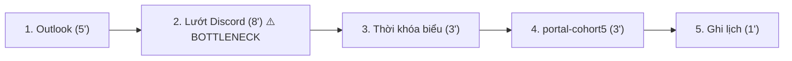

# Báo cáo cá nhân — 2A202603925_NguyenHuyTan

**Chủ đề:** Thông báo, deadline và lịch học của khóa học bị rải rác ở nhiều kênh.

**Nhân vật:** Tấn, học viên khóa AI20K (Cohort V) của VinUni. Mỗi ngày, sau buổi học, Tấn phải tự lướt 4 kênh để không sót thông báo, deadline và thay đổi lịch học:
- **Outlook**: email từ ban tổ chức, coach.
- **Discord**: kênh thông báo và các kênh lớp, khoảng 100 học viên.
- **Trang Thời khóa biểu AI20K – Cohort V**: lịch học, đổi giờ, đổi phòng.
- **portal-cohort5.edufun.ai**: bài lab, deadline nộp bài.

> Các con số ghi **[MINH HỌA]** là số ước lượng. Thay bằng số tự bấm giờ hoặc đếm thật trước khi nộp, rồi xóa nhãn.

---

## 2. Scan problem (CP1)

| # | Lăng kính | Job Story: Khi… tôi muốn… để… | Ai chịu ảnh hưởng? | Dấu hiệu thật [MINH HỌA] |
|---:|---|---|---|---|
| 1 | Lặp lại | Khi kết thúc buổi học mỗi ngày, tôi muốn biết có thông báo, deadline hay thay đổi lịch nào mới trên Outlook, Discord, trang Thời khóa biểu và portal, để sắp xếp việc cho ngày mai | Tấn, ~100 học viên Cohort V | Mỗi tối ~20' lướt 4 kênh; tháng trước 2 lần biết đổi lịch muộn |
| 2 | Pain từ người khác | Khi lịch học hoặc deadline bị đổi, các bạn trong lớp muốn biết ngay, để không vào nhầm giờ hay nộp theo hạn cũ | ~100 học viên | Đếm Discord tuần trước: [ĐIỀN] tin hỏi lại "mấy giờ học / hạn nộp khi nào?" |
| 3 | Tốn thời gian | Khi chuẩn bị nộp bài lab trên portal, tôi muốn biết bài còn thiếu mục nào theo rubric, để không bị trừ điểm cấu trúc | Học viên | ~20'/bài tự đối chiếu RUBRIC.md |
| 4 | Cần đọc, tổng hợp nhiều thông tin | Khi một thông báo dài trên Outlook có nhiều mục (lịch, nộp bài, sự kiện), tôi muốn nắm được việc nào cần làm và hạn khi nào, để không bỏ sót việc nằm ở cuối email | Học viên | ~3–4 email dài/tuần, mỗi email ~5' đọc |
| 5 | Lặp lại | Khi làm bài nhóm, tôi muốn biết ai đang làm phần nào, để không làm trùng | Nhóm 3 người | Lab trước 2 người cùng viết một mục |
| 6 | Tốn thời gian | Khi gặp lại một lỗi đã được coach giải đáp trên Discord, tôi muốn tìm lại được tin nhắn cũ, để không phải hỏi lại | Học viên, coach | ~10'/lần tìm, ~3 lần/tuần |

**Dùng AI gợi ý thêm:** [ĐIỀN SỰ THẬT: có hỏi AI không, giữ ý nào, bỏ ý nào, vì sao. Nếu không dùng thì ghi "Không dùng".]

---

## 3. Top 3 Problem Cards + quy trình nháp (CP2)

| Rank | Problem | Vì sao chọn | Điều còn chưa chắc |
|---:|---|---|---|
| 1 | Thông báo, deadline rải rác 4 kênh (#1) | Lặp lại mỗi ngày, đo được thời gian, cả ~100 người gặp | Các bạn khác có lướt đủ 4 kênh như mình không? |
| 2 | Đối chiếu rubric trước khi nộp (#3) | Quy trình rõ, có checklist sẵn | Có thể chỉ cần checklist là đủ |
| 3 | Tìm lại câu trả lời cũ trên Discord (#6) | Nhiều người gặp | Discord đã có tìm kiếm, pain có thể nhỏ |

### Problem Card #1 — Thông báo, deadline rải rác 4 kênh

| Trường | Nội dung |
|---|---|
| Job Story | Khi kết thúc buổi học mỗi ngày, tôi muốn biết có thông báo, deadline hay thay đổi lịch nào mới trên 4 kênh, để sắp xếp việc cho ngày mai |
| Actor | Học viên AI20K Cohort V (~100 người), vừa học vừa làm việc khác |
| Thời điểm / bối cảnh | Mỗi tối sau buổi học; và bất kỳ lúc nào lịch hoặc deadline bị đổi |
| Quy trình hiện tại | 1. Mở Outlook đọc email mới (5') · 2. Lướt Discord kênh thông báo và kênh lớp (8') · 3. Mở trang Thời khóa biểu xem lịch ngày mai (3') · 4. Mở portal-cohort5 xem bài lab và deadline (3') · 5. Ghi việc vào lịch cá nhân (1') |
| Bottleneck | Bước 2: lướt Discord, ~8'/ngày; thông báo đổi lịch hay bị trôi giữa nhiều tin chat [MINH HỌA] |
| Impact | ~20'/ngày ≈ 100'/tuần mỗi người; tháng trước 2 lần biết đổi lịch muộn [MINH HỌA] |
| Success metric | Thời gian kiểm tra: 20' → dưới 5'/ngày (tự bấm giờ 2 tuần). Số lần biết thay đổi muộn: 2/tháng → 0 |
| Phương án không dùng AI | Ban tổ chức thống nhất mọi thay đổi lịch/deadline đều cập nhật lên trang Thời khóa biểu và portal, kèm 1 tin ở kênh thông báo Discord; học viên bật thông báo riêng cho kênh đó |
| Giả thuyết về AI | AI đọc email và tin Discord, nhận ra tin nào là đổi lịch hoặc deadline |
| Cảm nhận nhanh | Rule (có thể No AI) |

### Problem Card #2 — Đối chiếu rubric trước khi nộp

[ĐIỀN đủ các trường như card #1 + quy trình nháp có số phút và bottleneck]

### Problem Card #3 — Tìm lại câu trả lời cũ trên Discord

[ĐIỀN đủ các trường như card #1 + quy trình nháp có số phút và bottleneck]

### Card muốn pitch nhất
- Card số: 1
- Vì sao: cả ~100 học viên đều gặp hằng ngày, dễ kiểm chứng ngay trong lớp
- Câu hỏi muốn nhóm phản biện: "Nếu mọi thay đổi đều được cập nhật lên trang Thời khóa biểu và portal thì problem này còn không?"

### AI đã phản biện card thế nào

[ĐIỀN SAU KHI CHẠY THẬT prompt "PM hoài nghi" trong `docs/01-worksheet.md` với card #1]

| Điểm yếu AI chỉ ra | Đồng ý? | Đã sửa gì |
|---|---|---|
| | | |
