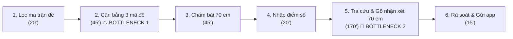
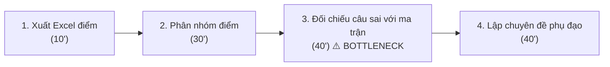
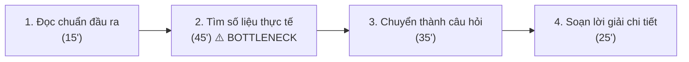

# Báo cáo cá nhân — 2A202603949_LeTuanDat

## 1. Thông tin học viên

- Họ tên: **Lê Tuấn Đạt**
- MSSV: **2A202603949**
- Lớp: **K5 - Level 3 (L3B)**
- Tên nhóm: **Nhom5W**
- Link repo nhóm: https://github.com/ngthanhtamtb/K5-L3B-DAY02-Nhom5W-DiscoveryProblemFraming
- Vai trò trong nhóm: Phụ trách Research giải pháp, thiết kế quy trình Trước/Sau, hoàn thiện Problem Statement v0/v1.

---

## 2. Scan problem (CP1)

Lăng kính quan sát: **Lặp lại** · **Tốn thời gian** · **Cần đọc, tổng hợp nhiều thông tin** · **Pain từ người khác**.

| # | Lăng kính | Job Story: Khi… tôi muốn… để… | Ai chịu ảnh hưởng? | Dấu hiệu thật (thời gian, tần suất, số người, bằng chứng) |
|---:|---|---|---|---|
| 1 | Lặp lại | Khi đến kỳ kiểm tra kỹ năng định kỳ 2 tuần/lần, tôi muốn có 3 mã đề thi tương đương chuẩn kiến thức từ ngân hàng câu hỏi, để kịp in phát cho học sinh mà không lo các em chép bài nhau | Giáo viên bộ môn (GV-A), 70 học sinh | Lặp lại 2 tuần/lần, mỗi lần mất khoảng 45 phút chỉ để đổi số liệu và đảo câu hỏi |
| 2 | Tốn thời gian | Khi chấm xong đợt kiểm tra kỹ năng 2 tuần/lần, tôi muốn có bản nhận xét tiến trình cá nhân hóa dựa trên câu sai của từng học sinh, để gửi phụ huynh qua app trường trước tối Chủ nhật mà không phải gõ tay thâu đêm | Giáo viên, phụ huynh, học sinh | 70 học sinh × 2.5–3 phút/em = 170–210 phút (chiếm trọn buổi tối cuối tuần) |
| 3 | Lặp lại | Khi kết thúc mỗi tuần học, tôi muốn cập nhật nhanh chuyên cần và điểm rèn luyện của lớp vào sổ điện tử, để nộp báo cáo tuần cho ban giám hiệu trước 11h sáng thứ Hai | Giáo viên chủ nhiệm, BGH | 35 học sinh/lớp, mất 40 phút mỗi sáng thứ Hai |
| 4 | Tốn thời gian | Khi cần chuẩn bị bài giảng kỹ năng mới, tôi muốn tìm nhanh các ví dụ tình huống thực tế sát đời sống gắn với chuẩn đầu ra, để học sinh không cảm thấy bài học khô khan | Giáo viên, học sinh | 60–90 phút mỗi bài soạn, giáo viên thường phải dùng lại ví dụ cũ từ năm trước |
| 5 | Cần đọc, tổng hợp nhiều thông tin | Khi kết thúc bài kiểm tra giữa kỳ, tôi muốn biết chính xác nhóm học sinh nào đang hổng kỹ năng/chuẩn đầu ra nào, để thiết kế kế hoạch phụ đạo đúng đối tượng | Giáo viên, tổ chuyên môn | Phải mất 2 tiếng xuất Excel, lọc điểm từng câu hỏi và vẽ biểu đồ phân phối điểm |
| 6 | Cần đọc, tổng hợp nhiều thông tin | Khi phụ huynh hỏi về tiến độ học tập 2 tháng qua của con, tôi muốn truy xuất nhanh lịch sử điểm và các lỗi sai điển hình, để tư vấn chính xác trong buổi họp phụ huynh | Giáo viên, phụ huynh | Mất 15 phút lục lại sổ tay hoặc các file điểm rời rạc cho mỗi phụ huynh |
| 7 | Pain từ người khác | Khi nhận thông báo kết quả bài kiểm tra định kỳ, phụ huynh muốn thấy rõ con tiến bộ ở đâu và yếu kỹ năng gì, để có định hướng kèm con học ở nhà | Phụ huynh, học sinh | Khảo sát nhanh:Phụ huynh có con lớp 10 (phỏng vấn CP4) cho biết nhận xét chỉ ghi chung chung nên phải chụp màn hình nhắn Zalo hỏi riêng cô giáo con sai phần nào; tổ trưởng chuyên môn ước tính ~70% giáo viên dùng câu mẫu |
| 8 | Pain từ người khác | Khi làm bài kiểm tra định kỳ, học sinh muốn độ khó giữa các mã đề phải thật sự công bằng, để không bị thiệt thòi điểm số so với bạn ngồi cạnh | 70 học sinh | Có 2 đợt học sinh khiếu nại mã đề 2 có bài toán thực tế dài và khó tính toán hơn mã đề 1 |
| 9 | Tốn thời gian | Khi nhận tin nhắn hỏi thăm bài vở từ 30 phụ huynh qua Zalo/Portal trường mỗi tuần, tôi muốn phân loại câu hỏi (học tập, xin nghỉ phép, hành chính), để không bỏ sót việc khẩn cấp | Giáo viên chủ nhiệm | Mất 15–20 phút mỗi tối đọc và trả lời các tin nhắn lặp lại |
| 10 | Cần đọc, tổng hợp nhiều thông tin | Khi họp tổ chuyên môn định kỳ 2 tuần, tổ trưởng muốn nắm tình hình hoàn thành chuẩn đầu ra của tất cả các khối lớp, để kịp thời điều chỉnh phân phối chương trình | Tổ trưởng bộ môn, BGH | Tổ trưởng mất cả buổi sáng tổng hợp báo cáo từ 6 giáo viên trong tổ |

**Phân tích việc dùng AI để gợi ý thêm:**
- Sau khi tự scan 8 ý từ thực tế quan sát trường học, tôi đã hỏi AI để gợi ý thêm góc nhìn. AI đề xuất thêm 2 ý: *"Phân loại tin nhắn phụ huynh"* (#9) và *"Tổng hợp tiến độ chuyên môn khối"* (#10).
- Tôi **giữ lại** cả 2 ý vì chúng phản ánh đúng áp lực hành chính hàng ngày của thầy cô.
- Tuy nhiên, tôi **bỏ qua** một ý AI đề xuất là *"AI tự động trò chuyện tư vấn tâm lý học sinh"* vì nhận thấy ý tưởng này quá mơ hồ, vi phạm nghiêm trọng ranh giới an toàn/đạo đức trong trường học và không có quy trình nghiệp vụ rõ ràng.

---

## 3. Top 3 Problem Cards + quy trình nháp (CP2)

### Bảng chọn top 3

| Rank | Problem | Vì sao chọn | Điều còn chưa chắc |
|---:|---|---|---|
| **1** | **Chu trình kiểm tra & nhận xét tiến trình của GV-A (#1 + #2)** | Quy trình lặp lại 2 tuần/lần rất rõ ràng; có baseline thời gian theo lời kể của giáo viên (chưa bấm giờ); pain lớn cho cả giáo viên và phụ huynh | Cần xác định ranh giới: AI chỉ soạn nháp nhận xét hay có được chấm điểm không? |
| 2 | Phân tích lỗ hổng chuẩn đầu ra sau kiểm tra (#5) | Tác động chuyên môn cao, giúp ích cho việc cá nhân hóa lộ trình học | Tần suất thấp hơn (thường 1–2 lần/học kỳ), không lặp lại thường xuyên bằng kiểm tra 2 tuần |
| 3 | Tìm kiếm ví dụ thực tế cho bài giảng kỹ năng (#4) | Pain thật của giáo viên khi soạn bài, tốn thời gian tìm tư liệu | Khó đo lường success metric khách quan (thế nào là một ví dụ "đủ hay"?) |

---

### Problem Card #1 — Chu trình kiểm tra định kỳ & nhận xét tiến trình cá nhân hóa (GV-A)

| Trường | Nội dung |
|---|---|
| **Job Story** | **Khi** đến chu kỳ kiểm tra kỹ năng 2 tuần/lần, **tôi muốn** có 3 mã đề thi tương đương độ khó từ ngân hàng đề và có nhận xét tiến trình cá nhân hóa theo lỗi sai của từng em, **để** kịp trả bài và gửi báo cáo học tập chi tiết cho phụ huynh trước tối Chủ nhật mà không kiệt sức vì làm việc thâu đêm |
| **Actor** | GV-A – Giáo viên THPT, phụ trách 2 lớp (70 học sinh) |
| **Thời điểm / bối cảnh** | Định kỳ mỗi 2 tuần, vào cuối tuần khi chuẩn bị trả bài kiểm tra kỹ năng |
| **Quy trình hiện tại (3–7 bước)** | 1. Lọc câu hỏi từ ngân hàng đề theo ma trận chuẩn đầu ra (20') 2. Soạn và cân bằng độ khó cho 3 mã đề + làm đáp án (45') 3. Chấm bài kiểm tra 70 học sinh (45') 4. Nhập điểm vào sổ điểm điện tử (20') 5. Tra cứu điểm cũ + gõ nhận xét tiến trình cá nhân hóa cho 70 học sinh (170') 6. Rà soát lại câu từ & gửi qua app trường (15') |
| **Bottleneck (bước nào, mất bao nhiêu phút)** | **Bước 2 (45 phút)**: Cân bằng số liệu và độ khó giữa 3 mã đề. **Bước 5 (170 phút)**: Tra cứu lịch sử câu sai và gõ lời nhận xét cho 70 học sinh $\to$ Đây là nút thắt lớn nhất |
| **Impact (nếu không giải thì sao)** | Tổng cộng mất **315 phút (~5.25 tiếng)** mỗi chu kỳ 2 tuần; giáo viên quá tải nên phải dùng câu mẫu rập khuôn ("Cần chú ý cẩn thận hơn"), tổ trưởng chuyên môn ước tính ~70% giáo viên làm vậy; phụ huynh bức xúc vì không nắm được con hổng kiến thức gì |
| **Success metric (baseline → target)** | **Thời gian:** Tổng chu kỳ giảm từ **315 phút xuống dưới 90 phút** (khâu nhận xét từ 170' xuống <35'). **Chất lượng:** Tỉ lệ nhận xét giáo viên phải gõ lại từ đầu **< 15%**. **Phụ huynh:** Tỉ lệ phụ huynh thấy nhận xét chỉ rõ phần con cần ôn: đo baseline trước pilot → **> 80%** |
| **Phương án không dùng AI** | Dùng template nhận xét cố định theo thang điểm (ví dụ: 5–6 điểm gắn câu A, 7–8 điểm gắn câu B): Nhanh nhưng biến thành rập khuôn hoàn toàn, mất đi tính cá nhân hóa và không chỉ ra được lỗ hổng kỹ năng |
| **Giả thuyết về AI (nếu có)** | Rule sinh 3 mã đề từ ngân hàng đề đã gắn mã kỹ năng; AI dựa vào danh sách câu sai của học sinh + dữ liệu bài trước để sinh nháp nhận xét 3 phần (Điểm mạnh, Lỗ hổng kỹ năng, Hướng khắc phục); GV-A duyệt trước khi gửi |
| **Cảm nhận nhanh** | **Workflow** (Các bước nghiệp vụ cố định, AI can thiệp ở bước soạn nháp văn bản và liên kết dữ liệu) |

#### Quy trình nháp hiện tại (Problem Card #1) — Tổng thời gian: 315 phút

---

### Problem Card #2 — Phân tích lỗ hổng chuẩn đầu ra sau kiểm tra định kỳ

| Trường | Nội dung |
|---|---|
| **Job Story** | **Khi** có kết quả bài kiểm tra kỹ năng của cả khối, **tôi muốn** biết chính xác nhóm học sinh nào đang hổng chuẩn kỹ năng nào, **để** kịp thời tổ chức buổi học phụ đạo phân hóa theo năng lực |
| **Actor** | Giáo viên bộ môn / Tổ phó chuyên môn |
| **Thời điểm / bối cảnh** | Sau các đợt kiểm tra lớn (định kỳ 1 tháng/lần) |
| **Quy trình hiện tại** | 1. Xuất file Excel điểm chi tiết (10') $\to$ 2. Nhập công thức phân nhóm học sinh (30') $\to$ 3. Đối chiếu câu hỏi với ma trận đề để tìm dạng bài sai nhiều (40') $\to$ 4. Lên danh sách chuyên đề phụ đạo (40') |
| **Bottleneck** | Bước 3: Đối chiếu thủ công từng mã câu hỏi với danh sách học sinh mất 40 phút |
| **Impact** | Tốn 120 phút; nếu không phân tích kịp thì tuần học kế tiếp vẫn dạy theo tiến độ chung, học sinh yếu bị hổng kiến thức lũy tiến |
| **Success metric** | Thời gian phân tích từ 120 phút xuống dưới 20 phút |
| **Phương án không dùng AI** | Viết macro/script Excel tự động đếm tần suất câu sai |
| **Giả thuyết về AI** | AI tóm tắt các cụm lỗi tư duy phổ biến của học sinh và đề xuất bài tập khắc phục |
| **Cảm nhận nhanh** | **Rule kết hợp Workflow** |

#### Quy trình nháp hiện tại (Problem Card #2) — 120 phút

---

### Problem Card #3 — Tìm kiếm ví dụ thực tế cho bài giảng kỹ năng

| Trường | Nội dung |
|---|---|
| **Job Story** | **Khi** soạn giáo án cho chuyên đề kỹ năng thực tế, **tôi muốn** có 3–5 ví dụ ngữ cảnh cập nhật gắn liền với đời sống Việt Nam, **để** học sinh hứng thú thảo luận và đạt chuẩn đầu ra bài học |
| **Actor** | Giáo viên THPT |
| **Thời điểm / bối cảnh** | Trước mỗi tiết học chuyên đề (hàng tuần) |
| **Quy trình hiện tại** | 1. Đọc yêu cầu chuẩn đầu ra (15') $\to$ 2. Lên Google/báo chí tìm số liệu & tin tức thực tế (45') $\to$ 3. Chuyển hóa số liệu thành câu hỏi bài tập (35') $\to$ 4. Làm lời giải chi tiết (25') |
| **Bottleneck** | Bước 2 (45'): Tìm kiếm dữ liệu thực tế phù hợp với lứa tuổi học sinh |
| **Impact** | Mất 120 phút/bài; nếu thiếu thời gian giáo viên đành dùng lại ví dụ cũ trong SGK |
| **Success metric** | Thời gian chuẩn bị ngữ cảnh giảm từ 45' xuống 10' |
| **Phương án không dùng AI** | Xây dựng kho tài liệu tình huống dùng chung của tổ chuyên môn |
| **Giả thuyết về AI** | LLM đóng vai trò trợ lý gợi ý tình huống thực tế theo chủ đề yêu cầu |
| **Cảm nhận nhanh** | **Workflow** |

#### Quy trình nháp hiện tại (Problem Card #3) — 120 phút

---

### Card muốn pitch nhất

- **Card số:** **Problem Card #1 (Chu trình kiểm tra & nhận xét tiến trình cá nhân hóa của GV-A)**.
- **Vì sao chọn:** Đây là bài toán có **nỗi đau lớn nhất, lặp lại thường xuyên nhất (2 tuần/lần)**, có số đo thời gian baseline rõ ràng (315 phút) và mang lại giá trị thiết thực tức thì cho cả 3 đối tượng: Giáo viên, Học sinh và Phụ huynh. Bài toán cũng giải quyết đồng thời sự liên kết chặt chẽ giữa việc ra đề chuẩn hóa và bóc tách lỗi sai để cá nhân hóa lời nhận xét.
- **Câu hỏi muốn nhóm phản biện:** *"Làm sao để đảm bảo AI sinh nhận xét dựa trên câu sai nhưng không bị biến thành một cỗ máy máy móc phán xét học sinh, và giáo viên duyệt 70 nhận xét trong bao lâu thì khả thi?"*

---

### AI đã phản biện card thế nào

| Điểm yếu AI chỉ ra | Đồng ý? | Đã sửa gì |
|---|---|---|
| Ban đầu tôi định cho AI tự động chấm bài thi bằng OCR trên giấy | **Đồng ý hoàn toàn** | Nhóm nhận ra OCR chữ viết tay của học sinh rất dễ nhầm lẫn, dẫn đến khiếu nại điểm số nghiêm trọng. Tôi đã **bỏ phần OCR**, chuyển sang hình thức chấm bài chuẩn hóa (hoặc giáo viên chấm điểm thô) và chỉ tập trung AI vào khâu sinh đề + soạn nháp nhận xét |
| Baseline 315 phút nghe có vẻ quá nhiều cho một giáo viên | **Đồng ý một phần** | Tôi đã giải thích chi tiết: 315 phút là tính cho **cả 2 lớp (70 học sinh)** của GV-A, chia nhỏ ra mỗi học sinh mất 2.5–3 phút gõ nhận xét kèm tra cứu điểm cũ là hoàn toàn chuẩn xác với thực tế |
| AI cảnh báo rủi ro thiên vị hoặc dùng từ ngữ làm tổn thương tâm lý học sinh | **Đồng ý** | Bổ sung ngay **Boundary (Ranh giới)** chặt chẽ: AI tuyệt đối không dùng từ ngữ tiêu cực (như "lười biếng, yếu kém"), chỉ nhận xét dựa trên dữ liệu kỹ năng đạt/chưa đạt; và giáo viên là chốt chặn cuối cùng duyệt 100% trước khi gửi |

---

## 4. Tôi đã tham gia phần nào (CP3 → CP7)

| Hoạt động | Tôi đã làm gì? | Kết quả / ảnh hưởng tới bài nhóm |
|---|---|---|
| **Pitch Problem Card** | Pitch 3 card về giáo viên THPT, trọng tâm là card #1: chu kỳ kiểm tra 2 tuần/lần và nhận xét tiến trình cho 70 học sinh của GV-A | Card #1 đạt 34/35 ở bảng chấm shortlist và được nhóm chọn làm candidate chung (group report mục 2.4) |
| **Phản biện bài của bạn khác** | Câu hỏi tôi đã đặt: (1) Hỏi Tâm, card #4 nhật ký thi công: *"Con số 45–60 phút/ngày lấy từ đâu, đã hỏi kỹ sư hiện trường nào chưa?"* (2) Hỏi Tâm, card #6 bản vẽ revision: *"Bản vẽ đang ở dạng PDF hay DWG? Nếu là DWG thì phần mềm CAD có sẵn chức năng so revision chưa?"* (3) Hỏi Tấn, card #7 thông báo 4 kênh: *"Nếu ban tổ chức chỉ cập nhật thay đổi ở một kênh chính thức thì problem này còn không?"* | Tâm xác nhận số liệu card #4 là giả thuyết `[GT]`, chưa phỏng vấn kỹ sư nào, nên card #4 bị loại vì không kiểm chứng được trong buổi lab. Card #7 bị loại vì No AI/Rule (một nguồn thông báo chính thức) đã đủ giải |
| **Nhận phản biện** | Câu hỏi tôi nhận được: (1) Tâm hỏi card #1: *"Giáo viên duyệt 70 bản nháp trong 35 phút có thực tế không, hay sẽ đọc lướt rồi bấm gửi?"* (2) Tấn hỏi card #2: *"Việc này chỉ 1–2 lần/học kỳ, có đủ lặp lại để đáng làm không?"* (3) Tấn hỏi card #3: *"Đo thế nào thì một ví dụ được coi là đủ hay?"* | Tôi đã sửa gì: đưa thời gian duyệt 35 phút vào Assumption Map thành giả định #4 (Usability) để đo trong pilot, và giữ ngưỡng dừng "viết lại trên 35% bản nháp". Đồng ý card #2 và #3 không vào shortlist vì tần suất thấp và metric khó đo |
| **Gom cluster / cây OST** | Cùng nhóm gom 9 card thành 4 cluster theo kiểu công việc (không theo ngành); đề xuất gạch "OCR chấm bài giấy" khỏi cây vì đó là solution | Cây OST có 1 outcome và các nhánh đều là pain (group report mục 2.2, 2.3) |
| **Chọn candidate problem** | Cùng chấm 7 tiêu chí cho 3 card shortlist (#1, #7, #4) | Nhóm chọn #1 (34 điểm), loại #7 (27) và #4 (23) có lý do |
| **Kiểm chứng / research** | Tự mở trang chủ Azota, K12Online, Khan Academy, ChatGPT ngày 09/11/2026 và làm bảng research | Sửa claim "các công cụ hoàn toàn chưa có..." thành "trang chủ không nêu..." vì nhóm chưa dùng thử bản đầy đủ (group report mục 3.3) |
| **Quy trình nhóm** | Vẽ quy trình Before (315') và After (115') bằng Mermaid | Giữ bước chấm bài 45' vì GV-A nói chấm không phải chỗ nghẽn; phần tiết kiệm đến từ bước soạn đề và bước nhận xét (group report mục 4) |
| **Problem Statement** | Viết v0, sau đó sửa lên v1 | v1 thêm 2 metric chất lượng (tỉ lệ viết lại < 15%, phụ huynh thấy nhận xét chỉ rõ phần cần ôn > 80%) và boundary "AI không nhận họ tên học sinh" (group report mục 5, 7) |
| **Mức can thiệp AI** | Bảo vệ lựa chọn Workflow: Rule làm bước 1 và 3, AI chỉ ở bước 4, giáo viên duyệt | Nhóm không chọn Agent vì quy trình cố định và tổ trưởng yêu cầu giáo viên duyệt trước khi gửi |
| **Quyết định** | Tham gia đánh giá 4 rủi ro và đặt ngưỡng dừng | Go, pilot 4 tuần trên 1 lớp 35 học sinh, có 3 ngưỡng dừng đo được (group report mục 8) |

---

## 5. Dùng AI

| Checkpoint | Tôi dùng AI để làm gì? | AI hữu ích ở đâu? | AI sai hoặc hời hợt ở đâu? | Tôi sửa gì bằng nhận định của mình? |
|---|---|---|---|---|
| **CP1 Scan** | Gợi ý thêm các khía cạnh công việc của giáo viên, sau khi đã tự scan | Gợi ý ra bài toán phân loại tin nhắn phụ huynh và tổng hợp tiến độ chuyên môn khối | Đề xuất một ý quá rộng: "AI làm trợ lý tâm lý cho học sinh" | Loại ý trợ lý tâm lý vì vượt phạm vi và có rủi ro đạo đức trong trường học |
| **CP2 Problem Card** | Cho AI đóng vai PM hoài nghi phản biện card #1 | Chỉ ra rủi ro khi đưa OCR vào bài toán và cảnh báo vấn đề tâm lý học sinh | Cho rằng baseline 315 phút "quá nhiều cho một giáo viên"; có lúc gợi ý cho hệ thống tự gửi nhận xét cho phụ huynh | Giữ 315' vì tính cho 70 học sinh, nhưng ghi rõ là số theo lời kể, chưa bấm giờ. Bác ý tự gửi: giáo viên phải là người bấm gửi |
| **CP4 Research** | Tìm các công cụ EdTech đang có | Liệt kê nhanh tính năng cơ bản của Azota và Khan Academy | Nhận định sai rằng Azota đã có phân tích kỹ năng dài hạn; đưa một số link nước ngoài không hợp chương trình Việt Nam | Tự mở trang chủ Azota và K12Online (09/11/2026) và chỉ ghi những gì trang chủ thật sự nêu |
| **CP5 Quy trình** | Chuyển mô tả các bước sang cú pháp Mermaid | Sinh sơ đồ nhanh | Gộp bước "Chấm bài" và "Gõ nhận xét" làm một; có bản nháp rút bước chấm bài từ 65' xuống 35' mà không có lý do | Tách riêng hai bước; giữ chấm + nhập điểm 65' theo lời GV-A, tổng After thành 115' |
| **CP5–6 Problem Statement** | Nhờ AI chỉ ra lỗ hổng trong Problem Statement | Nhắc bổ sung chỉ số chất lượng bên cạnh chỉ số tốc độ; chỉ ra số "35% phụ huynh hài lòng" không có nguồn | Gợi ý viết dài dòng, nhiều thuật ngữ kỹ thuật (Prompting, Vector DB) | Viết lại ngắn theo góc nhìn GV-A; bỏ số 35%, đổi sang đo baseline phụ huynh trước pilot |
| **CP6 Mức can thiệp / quyết định** | Gợi ý tiêu chí đánh giá cho bộ eval | Gợi ý tốt tiêu chí phát hiện ảo giác và độ dài nhận xét | Đánh giá rủi ro Viability là "Thấp" một cách chủ quan | Sửa thành "Trung bình" vì việc trường cho phép dùng AI mới chỉ là câu trả lời cho câu hỏi giả định |

---

## 6. Reflection (CP7)

### 6.1. Tôi học được gì khi nghe top 3 problems của các bạn khác?
Khi nghe Tâm pitch 3 card về công trường xây dựng (nhật ký thi công hằng ngày, hồ sơ nghiệm thu, bản vẽ revision) và Tấn pitch 3 card về việc học của học viên AI20K (thông báo rải rác 4 kênh, đối chiếu rubric, tìm tin cũ trên Discord), tôi thấy 3 bối cảnh hoàn toàn khác nhau nhưng lại lặp lại chung một kiểu vấn đề: dữ liệu gốc đã có, chỉ là người làm phải tự đọc gom và chép tay lại thành báo cáo cho người khác (như card #1 của tôi và card #4 của Tâm). Riêng card #7 thông báo 4 kênh của Tấn cho tôi thấy một điểm rất thực tế: không phải bài toán nào tốn thời gian cũng cần giải bằng AI — chỉ cần ban tổ chức chốt một kênh thông báo chính thức (No AI / Rule) là giải quyết được phần lớn.

### 6.2. Nhóm có lúc nào bị "solution-first" không? Lúc đó nhóm nhận ra và xử lý thế nào?
Có, và người mắc bẫy solution-first đầu tiên là chính tôi ở bản nháp đầu của card #1. Trước khi hỏi kỹ xem GV-A thật sự nghẽn ở khâu nào, tôi đã nghĩ ngay đến việc làm hệ thống OCR chấm bài giấy kèm AI. Tôi nhận ra điểm sai này từ CP2 khi dùng AI đóng vai PM hoài nghi phản biện card: AI chỉ ra rủi ro OCR chữ viết tay dễ chấm nhầm gây khiếu nại điểm số, cô xác nhận chấm theo barem chỉ mất 45 phút và không phải chỗ nghẽn, nên nhóm bỏ hẳn OCR để tập trung đúng vào khâu từ sau khi chấm đến soạn nháp nhận xét.

### 6.3. Tôi có đổi ý sau khi bị phản biện không? Kể một lần cụ thể.
Có. Lúc pitch card #1 ở CP3, tôi từng ước lượng khá lạc quan rằng chỉ cần có bản nháp sẵn thì GV-A duyệt lại 70 nhận xét trong 35 phút là vừa kịp. Tâm hỏi thẳng lại tôi: *"Giáo viên duyệt 70 bản nháp trong 35 phút có thực tế không, hay sẽ đọc lướt rồi bấm gửi?"*. Câu hỏi đó làm tôi phải nghĩ lại ngay: nếu tối Chủ nhật cô giáo mệt rồi lướt ẩu bấm gửi nhầm một nhận xét sai cho phụ huynh thì còn tệ hơn dùng câu mẫu. Tôi bỏ suy nghĩ mặc định đó, đưa thời gian duyệt 35 phút vào Assumption Map thành giả định #4 (Usability) để đo thật khi chạy pilot, và đặt kèm ngưỡng dừng "nếu giáo viên phải viết lại trên 35% bản nháp".

### 6.4. Kết quả kiểm chứng (phỏng vấn/research) có làm tôi bất ngờ không? Điều gì?
Khi trực tiếp gọi điện phỏng vấn Chị M. (phụ huynh học sinh lớp 10) ở CP4, tôi khá bất ngờ vì phụ huynh bức xúc và cần thông tin cụ thể hơn tôi nghĩ. Trước đó tôi đoán phần lớn bố mẹ chỉ xem điểm rồi đọc qua một câu nhận xét ngắn cho xong, nhưng Chị M. nói thẳng: *"Xem điểm con được 7.5 thì tôi biết thế thôi, chứ tôi đâu biết cháu hổng phần nào."* Chị còn kể phải chụp màn hình gửi Zalo hỏi riêng cô giáo buổi tối, làm tốn thêm thời gian của cả hai bên. Ngoài ra, lúc tự mở trang chủ Azota và K12Online kiểm tra ngày 09/11/2026, tôi cũng hơi ngạc nhiên vì hai công cụ phổ biến này hỗ trợ chấm trắc nghiệm và báo cáo điểm rất mạnh nhưng trang chủ không hề nêu bước biến dữ liệu câu sai qua nhiều đợt thành nháp nhận xét tiến trình gửi phụ huynh.

### 6.5. Điều khó nhất khi viết Problem Statement là gì?
Khó nhất với tôi là tách hết phần giải pháp ra khỏi mô tả vấn đề và đặt metric cho phía phụ huynh khi chưa có số liệu gốc. Ở những bản nháp đầu, tôi rất hay lồng cách làm kỹ thuật vào câu mô tả pain, đồng thời có lúc tự ước lượng mục tiêu thiếu cơ sở (như từng ghi kéo tổng chu kỳ xuống dưới 90 phút hoặc đặt tỷ lệ phụ huynh hài lòng 35% không có nguồn đo). Khi sửa từ v0 lên v1 cùng nhóm, tôi phải cắt sạch phần công cụ khỏi bài toán, giữ rõ Boundary (AI chỉ nhận mã học sinh, điểm, mã câu sai chứ không nhận họ tên), chỉnh mục tiêu tổng thời gian về dưới 120 phút cho khớp quy trình After 115 phút, và đổi metric phụ huynh sang khảo sát 1 câu Có/Không lấy baseline thật trước pilot.

### 6.6. Nếu làm lại, tôi sẽ đổi gì? Tôi sẽ phản biện nhóm mạnh hơn ở điểm nào?
Nếu làm lại từ đầu, tôi sẽ nhờ GV-A bấm giờ thử một chu kỳ kiểm tra thật trước khi chốt baseline, thay vì dùng ngay con số 315 phút từ lời kể ước lượng của cô — vì lúc mệt vào tối Chủ nhật, ước lượng "gần 3 tiếng" rất dễ lệch so với thực tế. Về phía nhóm, tôi sẽ phản biện mạnh hơn ở bước kiểm chứng CP4 về cỡ mẫu: hiện nhóm mới phỏng vấn được 1 giáo viên, 1 tổ trưởng và 1 phụ huynh (mỗi vai đúng 1 người), vẫn còn mỏng và dễ mang tính cá biệt của GV-A. Nếu có thêm thời gian trước khi mở pilot, tôi muốn hỏi chéo thêm vài giáo viên khác trong tổ và ít nhất 5–10 phụ huynh nữa.

### 6.7. Hiểu bài (problem → quy trình → metric → boundary → mức can thiệp AI → quyết định)
1. **Problem:** GV-A (giáo viên Toán THPT, 2 lớp, 70 học sinh) mất khoảng 315 phút mỗi chu kỳ kiểm tra 2 tuần, trong đó 170 phút là tra lại lỗi cũ và gõ nhận xét cho từng em, nên cuối cùng phải dùng câu mẫu và phụ huynh không biết con hổng phần nào.
2. **Quy trình:** Rule xuất 3 mã đề từ ngân hàng đề gắn mã kỹ năng → giáo viên chấm và nhập điểm kèm mã câu sai → Rule ánh xạ câu sai sang chuẩn kỹ năng và kéo kết quả bài trước → AI soạn nháp nhận xét 3 phần → giáo viên duyệt, sửa và tự bấm gửi.
3. **Metric:** tổng thời gian từ 315 phút xuống dưới 120 phút (bấm giờ 1 chu kỳ trước pilot để có baseline thật); dưới 15% bản nháp phải viết lại; trên 80% phụ huynh lớp pilot thấy nhận xét chỉ rõ con cần ôn phần nào.
4. **Boundary:** AI không tự gửi cho phụ huynh, không sửa điểm, không dùng từ phán xét học sinh, và chỉ nhận mã học sinh, điểm, mã câu sai, không nhận họ tên.
5. **Mức can thiệp:** Workflow, vì các bước cố định; No AI chính là câu mẫu đang bị phụ huynh chê, Rule chỉ liệt kê được câu sai, còn Agent không cần vì không có nhánh nào phải tự quyết.
6. **Quyết định:** Go phạm vi nhỏ, pilot 4 tuần trên 1 lớp 35 học sinh; dừng nếu giáo viên phải viết lại trên 35% bản nháp, nếu có 1 nhận xét ghi sai dữ liệu, hoặc nếu trường không cho dùng công cụ AI.

---

## 7. Tài liệu tham khảo

1. Biên bản phỏng vấn CP4 của nhóm: `report/assets/cp4-interview-snapshot-1.md` đến `-3.md`.
2. Rob Fitzpatrick — *The Mom Test*: https://www.momtestbook.com/
3. Google PAIR — *People + AI Guidebook*: https://pair.withgoogle.com/chapter/user-needs/
4. Trang chủ Azota (https://azota.vn/) và K12Online (https://k12online.vn/), kiểm ngày 09/11/2026.
