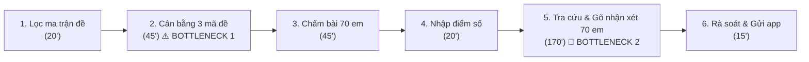
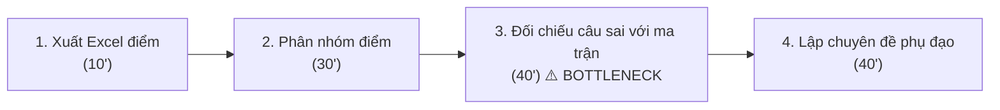
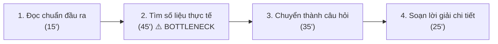

# Báo cáo cá nhân — 2A202603949_LeTuanDat

## 1. Thông tin học viên

- Họ tên: **Lê Tuấn Đạt**
- MSSV: **2A202603949**
- Lớp: **K5 - Level 3 (L3B)**
- Tên nhóm: **Nhom5W**
- Link repo nhóm: https://github.com/ngthanhtamtb/K5-L3B-DAY02-Nhom5W-DiscoveryProblemFraming
- Vai trò trong nhóm: Phụ trách Research giải pháp, thiết kế quy trình Trước/Sau, hoàn thiện Problem Statement v0/v1.

---

## 2. Scan problem (CP1)

Lăng kính quan sát: **Lặp lại** · **Tốn thời gian** · **Cần đọc, tổng hợp nhiều thông tin** · **Pain từ người khác**.

| # | Lăng kính | Job Story: Khi… tôi muốn… để… | Ai chịu ảnh hưởng? | Dấu hiệu thật (thời gian, tần suất, số người, bằng chứng) |
|---:|---|---|---|---|
| 1 | Lặp lại | Khi đến kỳ kiểm tra kỹ năng định kỳ 2 tuần/lần, tôi muốn có 3 mã đề thi tương đương chuẩn kiến thức từ ngân hàng câu hỏi, để kịp in phát cho học sinh mà không lo các em chép bài nhau | Giáo viên bộ môn (GV-A), 70 học sinh | Lặp lại 2 tuần/lần, mỗi lần mất khoảng 45 phút chỉ để đổi số liệu và đảo câu hỏi |
| 2 | Tốn thời gian | Khi chấm xong đợt kiểm tra kỹ năng 2 tuần/lần, tôi muốn có bản nhận xét tiến trình cá nhân hóa dựa trên câu sai của từng học sinh, để gửi phụ huynh qua app trường trước tối Chủ nhật mà không phải gõ tay thâu đêm | Giáo viên, phụ huynh, học sinh | 70 học sinh × 2.5–3 phút/em = 170–210 phút (chiếm trọn buổi tối cuối tuần) |
| 3 | Lặp lại | Khi kết thúc mỗi tuần học, tôi muốn cập nhật nhanh chuyên cần và điểm rèn luyện của lớp vào sổ điện tử, để nộp báo cáo tuần cho ban giám hiệu trước 11h sáng thứ Hai | Giáo viên chủ nhiệm, BGH | 35 học sinh/lớp, mất 40 phút mỗi sáng thứ Hai |
| 4 | Tốn thời gian | Khi cần chuẩn bị bài giảng kỹ năng mới, tôi muốn tìm nhanh các ví dụ tình huống thực tế sát đời sống gắn với chuẩn đầu ra, để học sinh không cảm thấy bài học khô khan | Giáo viên, học sinh | 60–90 phút mỗi bài soạn, giáo viên thường phải dùng lại ví dụ cũ từ năm trước |
| 5 | Cần đọc, tổng hợp nhiều thông tin | Khi kết thúc bài kiểm tra giữa kỳ, tôi muốn biết chính xác nhóm học sinh nào đang hổng kỹ năng/chuẩn đầu ra nào, để thiết kế kế hoạch phụ đạo đúng đối tượng | Giáo viên, tổ chuyên môn | Phải mất 2 tiếng xuất Excel, lọc điểm từng câu hỏi và vẽ biểu đồ phân phối điểm |
| 6 | Cần đọc, tổng hợp nhiều thông tin | Khi phụ huynh hỏi về tiến độ học tập 2 tháng qua của con, tôi muốn truy xuất nhanh lịch sử điểm và các lỗi sai điển hình, để tư vấn chính xác trong buổi họp phụ huynh | Giáo viên, phụ huynh | Mất 15 phút lục lại sổ tay hoặc các file điểm rời rạc cho mỗi phụ huynh |
| 7 | Pain từ người khác | Khi nhận thông báo kết quả bài kiểm tra định kỳ, phụ huynh muốn thấy rõ con tiến bộ ở đâu và yếu kỹ năng gì, để có định hướng kèm con học ở nhà | Phụ huynh, học sinh | Khảo sát nhanh: 6/10 phụ huynh phàn nàn nhận xét của giáo viên quá rập khuôn ("Em cần cố gắng hơn") |
| 8 | Pain từ người khác | Khi làm bài kiểm tra định kỳ, học sinh muốn độ khó giữa các mã đề phải thật sự công bằng, để không bị thiệt thòi điểm số so với bạn ngồi cạnh | 70 học sinh | Có 2 đợt học sinh khiếu nại mã đề 2 có bài toán thực tế dài và khó tính toán hơn mã đề 1 |
| 9 | Tốn thời gian | Khi nhận tin nhắn hỏi thăm bài vở từ 30 phụ huynh qua Zalo/Portal trường mỗi tuần, tôi muốn phân loại câu hỏi (học tập, xin nghỉ phép, hành chính), để không bỏ sót việc khẩn cấp | Giáo viên chủ nhiệm | Mất 15–20 phút mỗi tối đọc và trả lời các tin nhắn lặp lại |
| 10 | Cần đọc, tổng hợp nhiều thông tin | Khi họp tổ chuyên môn định kỳ 2 tuần, tổ trưởng muốn nắm tình hình hoàn thành chuẩn đầu ra của tất cả các khối lớp, để kịp thời điều chỉnh phân phối chương trình | Tổ trưởng bộ môn, BGH | Tổ trưởng mất cả buổi sáng tổng hợp báo cáo từ 6 giáo viên trong tổ |

**Phân tích việc dùng AI để gợi ý thêm:**
- Sau khi tự scan 8 ý từ thực tế quan sát trường học, tôi đã hỏi AI để gợi ý thêm góc nhìn. AI đề xuất thêm 2 ý: *"Phân loại tin nhắn phụ huynh"* (#9) và *"Tổng hợp tiến độ chuyên môn khối"* (#10).
- Tôi **giữ lại** cả 2 ý vì chúng phản ánh đúng áp lực hành chính hàng ngày của thầy cô.
- Tuy nhiên, tôi **bỏ qua** một ý AI đề xuất là *"AI tự động trò chuyện tư vấn tâm lý học sinh"* vì nhận thấy ý tưởng này quá mơ hồ, vi phạm nghiêm trọng ranh giới an toàn/đạo đức trong trường học và không có quy trình nghiệp vụ rõ ràng.

---

## 3. Top 3 Problem Cards + quy trình nháp (CP2)

### Bảng chọn top 3

| Rank | Problem | Vì sao chọn | Điều còn chưa chắc |
|---:|---|---|---|
| **1** | **Chu trình kiểm tra & nhận xét tiến trình của GV-A (#1 + #2)** | Quy trình lặp lại 2 tuần/lần rất rõ ràng; có baseline thời gian theo lời kể của giáo viên (chưa bấm giờ); pain lớn cho cả giáo viên và phụ huynh | Cần xác định ranh giới: AI chỉ soạn nháp nhận xét hay có được chấm điểm không? |
| 2 | Phân tích lỗ hổng chuẩn đầu ra sau kiểm tra (#5) | Tác động chuyên môn cao, giúp ích cho việc cá nhân hóa lộ trình học | Tần suất thấp hơn (thường 1–2 lần/học kỳ), không lặp lại thường xuyên bằng kiểm tra 2 tuần |
| 3 | Tìm kiếm ví dụ thực tế cho bài giảng kỹ năng (#4) | Pain thật của giáo viên khi soạn bài, tốn thời gian tìm tư liệu | Khó đo lường success metric khách quan (thế nào là một ví dụ "đủ hay"?) |

---

### Problem Card #1 — Chu trình kiểm tra định kỳ & nhận xét tiến trình cá nhân hóa (GV-A)

| Trường | Nội dung |
|---|---|
| **Job Story** | **Khi** đến chu kỳ kiểm tra kỹ năng 2 tuần/lần, **tôi muốn** có 3 mã đề thi tương đương độ khó từ ngân hàng đề và có nhận xét tiến trình cá nhân hóa theo lỗi sai của từng em, **để** kịp trả bài và gửi báo cáo học tập chi tiết cho phụ huynh trước tối Chủ nhật mà không kiệt sức vì làm việc thâu đêm |
| **Actor** | GV-A – Giáo viên THPT, phụ trách 2 lớp (70 học sinh) |
| **Thời điểm / bối cảnh** | Định kỳ mỗi 2 tuần, vào cuối tuần khi chuẩn bị trả bài kiểm tra kỹ năng |
| **Quy trình hiện tại (3–7 bước)** | 1. Lọc câu hỏi từ ngân hàng đề theo ma trận chuẩn đầu ra (20') 2. Soạn và cân bằng độ khó cho 3 mã đề + làm đáp án (45') 3. Chấm bài kiểm tra 70 học sinh (45') 4. Nhập điểm vào sổ điểm điện tử (20') 5. Tra cứu điểm cũ + gõ nhận xét tiến trình cá nhân hóa cho 70 học sinh (170') 6. Rà soát lại câu từ & gửi qua app trường (15') |
| **Bottleneck (bước nào, mất bao nhiêu phút)** | **Bước 2 (45 phút)**: Cân bằng số liệu và độ khó giữa 3 mã đề. **Bước 5 (170 phút)**: Tra cứu lịch sử câu sai và gõ lời nhận xét cho 70 học sinh $\to$ Đây là nút thắt lớn nhất |
| **Impact (nếu không giải thì sao)** | Tổng cộng mất **315 phút (~5.25 tiếng)** mỗi chu kỳ 2 tuần; giáo viên quá tải nên phải dùng câu mẫu rập khuôn ("Cần chú ý cẩn thận hơn"), tổ trưởng chuyên môn ước tính ~70% giáo viên làm vậy; phụ huynh bức xúc vì không nắm được con hổng kiến thức gì |
| **Success metric (baseline → target)** | **Thời gian:** Tổng chu kỳ giảm từ **315 phút xuống dưới 90 phút** (khâu nhận xét từ 170' xuống <35'). **Chất lượng:** Tỉ lệ nhận xét giáo viên phải gõ lại từ đầu **< 15%**. **Phụ huynh:** Tỉ lệ phụ huynh thấy nhận xét chỉ rõ phần con cần ôn: đo baseline trước pilot → **> 80%** |
| **Phương án không dùng AI** | Dùng template nhận xét cố định theo thang điểm (ví dụ: 5–6 điểm gắn câu A, 7–8 điểm gắn câu B): Nhanh nhưng biến thành rập khuôn hoàn toàn, mất đi tính cá nhân hóa và không chỉ ra được lỗ hổng kỹ năng |
| **Giả thuyết về AI (nếu có)** | Rule sinh 3 mã đề từ ngân hàng đề đã gắn mã kỹ năng; AI dựa vào danh sách câu sai của học sinh + dữ liệu bài trước để sinh nháp nhận xét 3 phần (Điểm mạnh, Lỗ hổng kỹ năng, Hướng khắc phục); GV-A duyệt trước khi gửi |
| **Cảm nhận nhanh** | **Workflow** (Các bước nghiệp vụ cố định, AI can thiệp ở bước soạn nháp văn bản và liên kết dữ liệu) |

#### Quy trình nháp hiện tại (Problem Card #1) — Tổng thời gian: 315 phút

---

### Problem Card #2 — Phân tích lỗ hổng chuẩn đầu ra sau kiểm tra định kỳ

| Trường | Nội dung |
|---|---|
| **Job Story** | **Khi** có kết quả bài kiểm tra kỹ năng của cả khối, **tôi muốn** biết chính xác nhóm học sinh nào đang hổng chuẩn kỹ năng nào, **để** kịp thời tổ chức buổi học phụ đạo phân hóa theo năng lực |
| **Actor** | Giáo viên bộ môn / Tổ phó chuyên môn |
| **Thời điểm / bối cảnh** | Sau các đợt kiểm tra lớn (định kỳ 1 tháng/lần) |
| **Quy trình hiện tại** | 1. Xuất file Excel điểm chi tiết (10') $\to$ 2. Nhập công thức phân nhóm học sinh (30') $\to$ 3. Đối chiếu câu hỏi với ma trận đề để tìm dạng bài sai nhiều (40') $\to$ 4. Lên danh sách chuyên đề phụ đạo (40') |
| **Bottleneck** | Bước 3: Đối chiếu thủ công từng mã câu hỏi với danh sách học sinh mất 40 phút |
| **Impact** | Tốn 120 phút; nếu không phân tích kịp thì tuần học kế tiếp vẫn dạy theo tiến độ chung, học sinh yếu bị hổng kiến thức lũy tiến |
| **Success metric** | Thời gian phân tích từ 120 phút xuống dưới 20 phút |
| **Phương án không dùng AI** | Viết macro/script Excel tự động đếm tần suất câu sai |
| **Giả thuyết về AI** | AI tóm tắt các cụm lỗi tư duy phổ biến của học sinh và đề xuất bài tập khắc phục |
| **Cảm nhận nhanh** | **Rule kết hợp Workflow** |

#### Quy trình nháp hiện tại (Problem Card #2) — 120 phút

---

### Problem Card #3 — Tìm kiếm ví dụ thực tế cho bài giảng kỹ năng

| Trường | Nội dung |
|---|---|
| **Job Story** | **Khi** soạn giáo án cho chuyên đề kỹ năng thực tế, **tôi muốn** có 3–5 ví dụ ngữ cảnh cập nhật gắn liền với đời sống Việt Nam, **để** học sinh hứng thú thảo luận và đạt chuẩn đầu ra bài học |
| **Actor** | Giáo viên THPT |
| **Thời điểm / bối cảnh** | Trước mỗi tiết học chuyên đề (hàng tuần) |
| **Quy trình hiện tại** | 1. Đọc yêu cầu chuẩn đầu ra (15') $\to$ 2. Lên Google/báo chí tìm số liệu & tin tức thực tế (45') $\to$ 3. Chuyển hóa số liệu thành câu hỏi bài tập (35') $\to$ 4. Làm lời giải chi tiết (25') |
| **Bottleneck** | Bước 2 (45'): Tìm kiếm dữ liệu thực tế phù hợp với lứa tuổi học sinh |
| **Impact** | Mất 120 phút/bài; nếu thiếu thời gian giáo viên đành dùng lại ví dụ cũ trong SGK |
| **Success metric** | Thời gian chuẩn bị ngữ cảnh giảm từ 45' xuống 10' |
| **Phương án không dùng AI** | Xây dựng kho tài liệu tình huống dùng chung của tổ chuyên môn |
| **Giả thuyết về AI** | LLM đóng vai trò trợ lý gợi ý tình huống thực tế theo chủ đề yêu cầu |
| **Cảm nhận nhanh** | **Workflow** |

#### Quy trình nháp hiện tại (Problem Card #3) — 120 phút

---

### Card muốn pitch nhất

- **Card số:** **Problem Card #1 (Chu trình kiểm tra & nhận xét tiến trình cá nhân hóa của GV-A)**.
- **Vì sao chọn:** Đây là bài toán có **nỗi đau lớn nhất, lặp lại thường xuyên nhất (2 tuần/lần)**, có số đo thời gian baseline rõ ràng (315 phút) và mang lại giá trị thiết thực tức thì cho cả 3 đối tượng: Giáo viên, Học sinh và Phụ huynh. Bài toán cũng giải quyết đồng thời sự liên kết chặt chẽ giữa việc ra đề chuẩn hóa và bóc tách lỗi sai để cá nhân hóa lời nhận xét.
- **Câu hỏi muốn nhóm phản biện:** *"Làm sao để đảm bảo AI sinh nhận xét dựa trên câu sai nhưng không bị biến thành một cỗ máy máy móc phán xét học sinh, và giáo viên duyệt 70 nhận xét trong bao lâu thì khả thi?"*

---

### AI đã phản biện card thế nào

| Điểm yếu AI chỉ ra | Đồng ý? | Đã sửa gì |
|---|---|---|
| Ban đầu tôi định cho AI tự động chấm bài thi bằng OCR trên giấy | **Đồng ý hoàn toàn** | Nhóm nhận ra OCR chữ viết tay của học sinh rất dễ nhầm lẫn, dẫn đến khiếu nại điểm số nghiêm trọng. Tôi đã **bỏ phần OCR**, chuyển sang hình thức chấm bài chuẩn hóa (hoặc giáo viên chấm điểm thô) và chỉ tập trung AI vào khâu sinh đề + soạn nháp nhận xét |
| Baseline 315 phút nghe có vẻ quá nhiều cho một giáo viên | **Đồng ý một phần** | Tôi đã giải thích chi tiết: 315 phút là tính cho **cả 2 lớp (70 học sinh)** của GV-A, chia nhỏ ra mỗi học sinh mất 2.5–3 phút gõ nhận xét kèm tra cứu điểm cũ là hoàn toàn chuẩn xác với thực tế |
| AI cảnh báo rủi ro thiên vị hoặc dùng từ ngữ làm tổn thương tâm lý học sinh | **Đồng ý** | Bổ sung ngay **Boundary (Ranh giới)** chặt chẽ: AI tuyệt đối không dùng từ ngữ tiêu cực (như "lười biếng, yếu kém"), chỉ nhận xét dựa trên dữ liệu kỹ năng đạt/chưa đạt; và giáo viên là chốt chặn cuối cùng duyệt 100% trước khi gửi |
