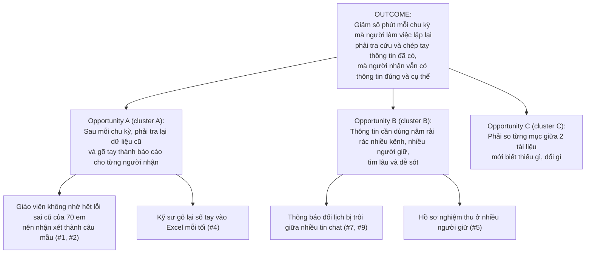
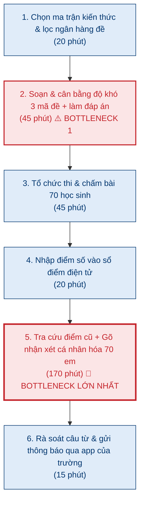
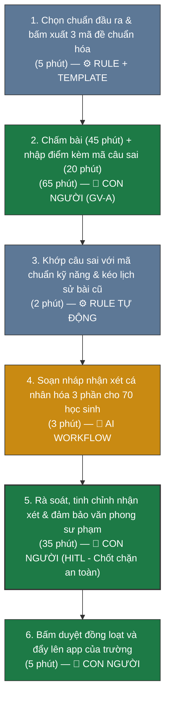

# Báo cáo nhóm — Day 02 Discovery & Problem Framing

## 1. Thông tin nhóm

- Tên nhóm: **Nhom5W**
- Lớp: **K5 - Level 3 (L3B)**
- Tên repo: `K5-L3B-DAY02-Nhom5W-DiscoveryProblemFraming`
- Thành viên: xem `TEAM.md` (Nguyễn Thành Tâm - Nhóm trưởng, Lê Tuấn Đạt, Nguyễn Huy Tấn)
- Candidate problem được chọn: **Tối ưu hóa chu trình kiểm tra định kỳ và tự động hóa báo cáo tiến trình học tập cá nhân hóa gửi phụ huynh cho giáo viên THPT.**
- Quyết định cuối: **Go, phạm vi nhỏ (Pilot 4 tuần trên 1 lớp 35 học sinh của GV-A).**
- Quy ước ẩn danh: **GV-A** = giáo viên Toán THPT được phỏng vấn ở CP4 (dạy 2 lớp, 70 học sinh). Báo cáo không ghi tên thật và tên trường của người được phỏng vấn (RULES mục 5).

---

## 2. Hội tụ nhóm (CP3)

### 2.1. Pitch

Mỗi thành viên pitch top 3 Problem Card trong file cá nhân của mình (tổng 9 candidate, thuộc 3 bối cảnh khác nhau). Người nghe ghi câu hỏi phản biện; không dùng AI ở bước này.

| # | Người đưa ra | Candidate (Job Story ngắn) | Actor | Bottleneck | Câu hỏi phản biện nhận được (ai hỏi) |
|---:|---|---|---|---|---|
| 1 | Lê Tuấn Đạt | Khi đến chu kỳ kiểm tra kỹ năng 2 tuần/lần, tôi muốn có 3 mã đề tương đương độ khó và nhận xét tiến trình cá nhân hóa theo lỗi sai của từng em, để gửi phụ huynh trước tối Chủ nhật | GV-A, giáo viên THPT dạy 2 lớp (70 học sinh) | Tra lịch sử câu sai và gõ nhận xét cho 70 em (170'); cân bằng 3 mã đề (45') — theo lời kể của GV-A | "Giáo viên duyệt 70 bản nháp trong 35 phút có thực tế không, hay sẽ đọc lướt rồi bấm gửi?" (Nguyễn Thành Tâm) |
| 2 | Lê Tuấn Đạt | Khi có kết quả kiểm tra kỹ năng của cả khối, tôi muốn biết nhóm học sinh nào đang hổng chuẩn kỹ năng nào, để kịp tổ chức buổi phụ đạo | Giáo viên bộ môn / Tổ phó chuyên môn | Đối chiếu thủ công từng mã câu hỏi với danh sách học sinh (40') | "Việc này chỉ 1–2 lần/học kỳ, có đủ lặp lại để đáng làm không?" (Nguyễn Huy Tấn) |
| 3 | Lê Tuấn Đạt | Khi soạn giáo án chuyên đề kỹ năng thực tế, tôi muốn có 3–5 ví dụ ngữ cảnh gắn với đời sống Việt Nam, để học sinh hứng thú thảo luận | Giáo viên THPT | Tìm số liệu, tin tức thực tế phù hợp lứa tuổi (45') | "Đo thế nào thì một ví dụ được coi là đủ hay?" (Nguyễn Huy Tấn) |
| 4 | Nguyễn Thành Tâm | Khi cuối mỗi ngày ở công trường, tôi muốn tổng hợp nhật ký thi công (khối lượng, nhân công, thiết bị, vật tư, sự cố) thành 1 báo cáo gửi văn phòng, để chỉ huy trưởng và chủ đầu tư nắm tiến độ | Kỹ sư hiện trường / Chỉ huy công trường | Gõ lại dữ liệu từ sổ tay vào Excel (~30–40'/ngày, giả thuyết chưa verify) | "Con số 45–60 phút/ngày lấy từ đâu, đã hỏi kỹ sư hiện trường nào chưa?" (Lê Tuấn Đạt) |
| 5 | Nguyễn Thành Tâm | Khi giám sát chủ đầu tư yêu cầu hồ sơ nghiệm thu một hạng mục, tôi muốn tập hợp đủ bộ hồ sơ trong ngày, để không làm chậm nghiệm thu và thanh toán đợt | Kỹ sư hiện trường / Kỹ sư hồ sơ | Chờ hồ sơ từ nhiều người giữ (~4–6 tiếng, giả thuyết chưa verify) | "Nghẽn là do chờ người khác gửi hồ sơ; có nhắc nhở thì họ có gửi nhanh hơn không, hay checklist + thư mục chung là đủ?" (Nguyễn Huy Tấn) |
| 6 | Nguyễn Thành Tâm | Khi nhận bộ bản vẽ revision mới, tôi muốn xác định nhanh các điểm thay đổi so với bản trước, để bàn giao đúng cho tổ thi công | Kỹ sư hiện trường | So sánh thủ công từng sheet bản vẽ (2–4 tiếng/lần, giả thuyết chưa verify) | "Bản vẽ đang ở dạng PDF hay DWG? Nếu là DWG thì phần mềm CAD có sẵn chức năng so revision chưa?" (Lê Tuấn Đạt) |
| 7 | Nguyễn Huy Tấn | Khi kết thúc buổi học mỗi ngày, tôi muốn biết có thông báo, deadline hay thay đổi lịch nào mới trên Outlook, Discord, trang Thời khóa biểu và portal, để sắp xếp việc cho ngày mai | Học viên AI20K Cohort V (~100 người) | Lướt Discord kênh thông báo và kênh lớp (~8'/ngày; cả 4 kênh ~20'/ngày, ước lượng) | "Nếu ban tổ chức chỉ cập nhật thay đổi ở một kênh chính thức thì problem này còn không?" (Lê Tuấn Đạt) |
| 8 | Nguyễn Huy Tấn | Khi chuẩn bị nộp bài lab trên portal, tôi muốn biết bài còn thiếu mục nào theo rubric, để không bị trừ điểm cấu trúc | Học viên | Tự đối chiếu bài với RUBRIC.md (~20'/bài, ước lượng) | "RUBRIC.md đã như một checklist, tự tick theo đó có đủ không?" (Nguyễn Thành Tâm) |
| 9 | Nguyễn Huy Tấn | Khi gặp lại một lỗi đã được coach giải đáp trên Discord, tôi muốn tìm lại được tin nhắn cũ, để không phải hỏi lại | Học viên, coach | Tìm lại tin nhắn cũ (~10'/lần, ~3 lần/tuần, ước lượng) | "Discord đã có ô tìm kiếm, vậy mất 10 phút là do tìm kiếm kém hay do không nhớ từ khóa?" (Nguyễn Thành Tâm) |

Câu hỏi mỗi người tự đặt sẵn cho card muốn pitch nhất (mục 3 file cá nhân):
- Đạt (#1): Làm sao để AI soạn nhận xét dựa trên câu sai mà không thành máy móc phán xét học sinh, và giáo viên duyệt 70 nhận xét trong bao lâu?
- Tâm (#4): Kỹ sư có chịu bỏ thói quen ghi sổ tay không? Nếu số liệu khối lượng bị parse sai mà không ai phát hiện thì ai chịu trách nhiệm?
- Tấn (#7): Nếu mọi thay đổi đều được cập nhật lên trang Thời khóa biểu và portal thì problem này còn không?

---

### 2.2. Cluster

Nhóm gom theo **pattern công việc**, không theo ngành, vì 9 candidate đến từ 3 bối cảnh khác nhau:

| Cluster | Các candidate | Pattern chung |
|---|---|---|
| **A — Chép lại dữ liệu thành báo cáo cho người khác** | #1 (nhận xét tiến trình gửi phụ huynh), #2 (danh sách học sinh hổng chuẩn), #4 (nhật ký thi công gửi văn phòng) | Dữ liệu đã có sau mỗi chu kỳ (câu sai, khối lượng) nhưng người làm phải tra lại và gõ tay thành văn bản cho người nhận khác nhau |
| **B — Gom thông tin rải rác ở nhiều nơi, nhiều người** | #5 (hồ sơ nghiệm thu), #7 (thông báo 4 kênh), #9 (tìm câu trả lời cũ trên Discord) | Thông tin cần dùng đã tồn tại nhưng nằm ở nhiều kênh hoặc nhiều người giữ; mất thời gian đi tìm và dễ sót |
| **C — Đối chiếu tài liệu với chuẩn hoặc với phiên bản trước** | #6 (bản vẽ revision), #8 (bài lab với rubric) | So từng mục giữa 2 tài liệu để tìm chỗ thiếu hoặc chỗ thay đổi |
| **D — Tìm tư liệu để soạn nội dung mới** | #3 (ví dụ thực tế cho bài giảng) | Việc sáng tạo, không có quy trình lặp cố định |

---

### 2.3. Opportunity Solution Tree rút gọn



Candidate #3 (cluster D) không đưa vào cây: đây là việc sáng tạo, khó đo theo phút/chu kỳ nên không khớp outcome.

**Những ý đã gạch bỏ vì là solution đội lốt opportunity:**
- *"Thiếu hệ thống OCR chấm bài giấy"* (card #1 bản đầu của Đạt): là tính năng, và phỏng vấn GV-A cho thấy chấm bài không phải chỗ nghẽn.
- *"Cần agent tự gửi báo cáo về văn phòng mỗi tối"* (gợi ý của AI cho card #4, Tâm đã bác trong file cá nhân): là solution, và bỏ mất bước kỹ sư xác nhận.
- *"Cần một app gom thông báo từ 4 kênh"* (card #7): là solution; pain thật là thông báo đổi lịch bị trôi và không có một nguồn chính thức.
- *"Cần chatbot trả lời phụ huynh"*: là solution, và đẩy rủi ro phát ngôn sang AI.

---

### 2.4. Chấm điểm shortlist (1–5)

Shortlist lấy card mạnh nhất của mỗi người, để so sánh giữa 3 bối cảnh:

| Candidate | Actor rõ | Quy trình rõ | Pain có bằng chứng | Impact đo được | Vừa sức lab | So sánh được No AI/Rule/Workflow/Agent | Nhóm hiểu domain | Tổng |
|---|---:|---:|---:|---:|---:|---:|---:|---:|
| **#1 — Kiểm tra định kỳ & nhận xét tiến trình (Đạt)** | 5 | 5 | 5 | 5 | 4 | 5 | 5 | **34** |
| #7 — Thông báo, deadline rải rác 4 kênh (Tấn) | 5 | 4 | 3 | 3 | 5 | 2 | 5 | 27 |
| #4 — Nhật ký thi công hằng ngày (Tâm) | 5 | 4 | 2 | 3 | 3 | 4 | 2 | 23 |

Lý do chấm:
- **#1:** actor và chu kỳ 2 tuần rõ; quy trình 6 bước có số phút; pain có bằng chứng từ 3 người được phỏng vấn (giáo viên, tổ trưởng, phụ huynh); có đủ chỗ để so 4 mức (template → Rule → Workflow → Agent). Trừ 1 ở "vừa sức lab" vì phụ thuộc ngân hàng đề đã gắn mã kỹ năng.
- **#7:** cả nhóm là học viên nên hiểu domain và kiểm chứng ngay trong lớp được. Nhưng số phút còn là ước lượng; impact ~20'/ngày; và chính Tấn đánh giá giải pháp hợp lý là No AI/Rule (ban tổ chức cập nhật một nguồn chính thức), nên không có gì để so mức Workflow/Agent.
- **#4:** actor và quy trình rõ, có cơ sở pháp lý (nhật ký thi công là bắt buộc). Nhưng mọi con số trong card là giả thuyết `[GT]` chưa verify, chỉ Tâm có hiểu biết domain, và trong thời gian lab nhóm không tiếp cận được kỹ sư hiện trường để phỏng vấn.

**Candidate được chọn:** **#1 — Chu trình kiểm tra định kỳ & nhận xét tiến trình cá nhân hóa của giáo viên THPT (GV-A).**

**Vì sao chọn:**
1. Actor và chu kỳ cụ thể: GV-A dạy 2 lớp (70 học sinh), kiểm tra kỹ năng 2 tuần/lần.
2. Bottleneck đo bằng phút: 315 phút/chu kỳ theo lời kể, trong đó gõ nhận xét chiếm 170 phút.
3. Kiểm chứng được ngay: nhóm tiếp cận được giáo viên, tổ trưởng chuyên môn và phụ huynh để phỏng vấn ở CP4.
4. So sánh được cả 4 mức can thiệp, không bị "đã biết trước là No AI".

**Vì sao loại các candidate còn lại:**
- **#7 (Tấn):** giải pháp No AI/Rule đã đủ (một nguồn thông báo chính thức + bật thông báo riêng cho kênh đó), và người quyết định là ban tổ chức chứ không phải học viên. Không còn gì để bàn về mức AI.
- **#4 (Tâm):** toàn bộ số liệu là giả thuyết, không phỏng vấn được kỹ sư trong buổi lab, nên không qua được CP4. Nhóm giữ lại làm hướng tiếp theo nếu Tâm có người quen trong ngành.
- **#2, #3 (Đạt):** #2 chỉ 1–2 lần/học kỳ; #3 khó đo success metric ("ví dụ đủ hay" là chủ quan).
- **#5, #6 (Tâm):** cùng vấn đề với #4 là số liệu chưa verify; #6 còn phụ thuộc bản vẽ PDF hay DWG.
- **#8, #9 (Tấn):** card chưa hoàn thiện; #8 có thể giải bằng checklist (No AI), #9 Discord đã có tìm kiếm nên pain có thể nhỏ (Tấn tự ghi trong bảng top 3).

**Xử lý bất đồng:** Bản đầu card #1 của Đạt có cả phần AI đọc OCR để chấm bài giấy. Ban đầu AI gợi ý (hơi quá tay) là nên giữ nguyên mô hình OCR kết hợp Deep Learning để nhận diện chữ viết tay của học sinh nhằm tự động hóa tối đa. Tuy nhiên, sau khi phỏng vấn GV-A xác nhận việc chấm bài đã có barem nhanh và chữ viết tay học sinh rất dễ bị chấm nhầm, **nhóm quyết định sửa lại quyết định của AI:** cắt bỏ hoàn toàn tính năng OCR, chỉ tập trung giải quyết từ khâu sau khi chấm (ánh xạ câu sai $\to$ soạn nháp nhận xét $\to$ giáo viên duyệt) cho phù hợp với thực tế và tránh rủi ro khiếu nại điểm số.

---

## 3. Kiểm chứng + research giải pháp đã có (CP4)

### 3.1. Assumption Map

| # | Giả định | Loại | Quan trọng (1–5) | Đã có bằng chứng (1–5) | Kiểm chứng trước? |
|---:|---|---|---:|---:|:---:|
| 1 | Giáo viên thật sự mất trên 2 tiếng mỗi đợt chỉ để gõ nhận xét tiến trình cho học sinh | **Value** | **5** | **2** | **✅ Kiểm trước** |
| 2 | Phụ huynh thật sự đọc và quan tâm đến chi tiết kỹ năng của con chứ không chỉ nhìn điểm số | **Value** | **5** | **2** | **✅ Kiểm trước** |
| 3 | Ngân hàng câu hỏi của trường đã được chuẩn hóa và gắn nhãn mã kỹ năng/chuẩn đầu ra | **Feasibility** | 4 | 3 | — |
| 4 | Giáo viên có thể duyệt và tinh chỉnh 70 bản nháp nhận xét trong vòng 35 phút mà không bị kiệt sức | **Usability** | 4 | 2 | — |
| 5 | Nhà trường cho phép ứng dụng công nghệ hỗ trợ soạn thảo nhận xét miễn là giáo viên chịu trách nhiệm duyệt | **Viability** | **5** | **1** | **✅ Kiểm trước** |

Nhóm chọn kiểm chứng ngay 3 giả định quan trọng nhất: **Giả định #1, #2 (Value)** và **Giả định #5 (Viability)** thông qua phương pháp phỏng vấn The Mom Test.

---

### 3.2. Kiểm chứng bằng phương pháp The Mom Test

Nhóm tiến hành phỏng vấn sâu 3 đối tượng thực tế (không hỏi câu hỏi tương lai "Thầy/cô có thích...", chỉ hỏi về hành vi và sự việc đã xảy ra trong quá khứ):

#### Interview Snapshot 1 — Giáo viên bộ môn (GV-A)
* **Người được hỏi:** GV-A – Giáo viên Toán/KHTN cấp THPT.
* **Thời điểm / cách hỏi:** 05/11/2026, phỏng vấn trực tiếp 1-1, 25 phút. Biên bản: [cp4-interview-snapshot-1.md](../assets/cp4-interview-snapshot-1.md)
* **Câu nói đáng nhớ nhất (nguyên văn):**  
  > *"Mỗi lần tới hạn trả điểm trên app trường vào tối Chủ nhật là tôi sợ phát khóc. Chấm điểm thì nhanh, nhưng ngồi nhìn tên từng đứa rồi nhớ xem tuần trước nó sai cái gì để gõ nhận xét tiến bộ thì kiệt sức hoàn toàn."*
* **Lần gần nhất gặp vấn đề:** Đợt kiểm tra 45 phút kỹ năng hình học không gian tuần trước (tính từ ngày phỏng vấn); gõ nhận xét cho hơn 70 học sinh (2 lớp) vào tối Chủ nhật vì sáng thứ Hai là hạn khóa sổ.
* **Workaround hiện tại:** Từ khoảng em thứ 25–30, mở file Word lưu sẵn câu mẫu theo khoảng điểm (8–9 điểm: "Làm bài tốt, tiếp tục phát huy"; 5–6 điểm: "Cần chú ý cẩn thận hơn, ôn lại lý thuyết") rồi copy.
* **Thời gian (theo lời kể, chưa bấm giờ):** gõ nhận xét 2–3 phút/em × hơn 70 em ≈ gần 3 tiếng (nhóm lấy 170 phút làm baseline); soạn 3 mã đề "gần 1 tiếng".
* **Insight rút ra:** Pain nằm ở bước nhớ lại lỗi sai cũ của từng em và gõ nhận xét, không nằm ở bước chấm bài.

#### Interview Snapshot 2 — Tổ trưởng chuyên môn / Ban giám hiệu
* **Người được hỏi:** Tổ trưởng chuyên môn Toán - Tin học, trường phổ thông.
* **Thời điểm / cách hỏi:** 06/11/2026, phỏng vấn trực tiếp tại trường, 20 phút. Biên bản: [cp4-interview-snapshot-2.md](../assets/cp4-interview-snapshot-2.md)
* **Câu nói đáng nhớ nhất (nguyên văn):**  
  > *"Nhà trường bắt buộc nhận xét phải mang tính cá nhân hóa theo định hướng chuẩn đầu ra Cambridge. Nhưng tôi đi kiểm tra sổ liên lạc thì thấy 70% giáo viên nhận xét như máy copy. Nếu có công cụ hỗ trợ giáo viên nháp sẵn dựa trên chuẩn kiến thức thì nhà trường rất khuyến khích, nhưng tuyệt đối giáo viên phải là người duyệt cuối cùng trước khi gửi cho phụ huynh."*
* **Lần gần nhất:** Kỳ họp phụ huynh vừa rồi, nhà trường nhận được thư phản ánh từ phụ huynh lớp 10 rằng nhận xét không giúp kèm con ở nhà. Khi kiểm tra sổ liên lạc, tổ trưởng ước tính khoảng 70% giáo viên dùng câu mẫu rập khuôn.
* **Insight rút ra:** Quy định đã có và chắc chắn: giáo viên phải đọc, duyệt trước khi gửi; phần mềm không được tự gửi cho phụ huynh (Human-in-the-loop là bắt buộc).
* **Lưu ý về độ tin cậy:** Ý "nhà trường rất khuyến khích công cụ hỗ trợ soạn nháp" là câu trả lời cho một **câu hỏi giả định** ("Nếu có một tiện ích..., nhà trường có cho phép áp dụng không?"). Theo The Mom Test, đây chỉ là tín hiệu yếu, chưa phải bằng chứng. Giả định #5 (Viability) vẫn cần xác nhận bằng văn bản hoặc quy định của trường trước pilot.

#### Interview Snapshot 3 — Phụ huynh học sinh lớp 10
* **Người được hỏi:** Phụ huynh có con học lớp 10 THPT.
* **Thời điểm / cách hỏi:** 06/11/2026, phỏng vấn qua điện thoại, 15 phút. Biên bản: [cp4-interview-snapshot-3.md](../assets/cp4-interview-snapshot-3.md)
* **Lần gần nhất:** Tuần trước nhận điểm Toán 7.5 của con; nhận xét chỉ ghi chung chung nên phải chụp màn hình, nhắn Zalo hỏi cô giáo con sai phần nào, tối muộn mới được trả lời.
* **Câu nói đáng nhớ nhất (nguyên văn):**  
  > *"Xem điểm con được 7.5 thì tôi biết thế thôi, chứ tôi đâu biết cháu hổng phần nào. Đọc nhận xét thấy cô ghi 'Cần cố gắng hơn' thì tuần nào cũng như tuần nào, chẳng biết phải bảo cháu ôn thêm bài nào ở nhà."*
* **Workaround hiện tại:** Phải nhắn tin riêng qua Zalo hỏi cô giáo xem con sai ở câu nào, khiến cô giáo lại mất thêm thời gian giải thích.
* **Insight rút ra:** Phụ huynh khao khát thông tin tiến trình thực chất (con tiến bộ kỹ năng nào, hổng kỹ năng nào, cần làm gì tiếp theo).

---

#### Tổng hợp tín hiệu xác nhận & phản bác:

| Nguồn | Số lượng | Tín hiệu xác nhận | Tín hiệu phản bác |
|---|---:|---|---|
| Phỏng vấn sâu | 3 người (1 giáo viên, 1 tổ trưởng, 1 phụ huynh) | GV-A mất gần 3 tiếng gõ nhận xét mỗi đợt và phải dùng câu mẫu; tổ trưởng ước tính ~70% giáo viên dùng câu mẫu; phụ huynh không biết con hổng phần nào nên phải nhắn hỏi riêng | GV-A: chấm bài **không** phải nút thắt (đã có barem/máy quét) → bỏ ý OCR. Tổ trưởng: cấm phần mềm tự gửi, giáo viên phải duyệt từng câu. Phụ huynh: nhận xét phải ngắn, đọc được trong khoảng 1 phút |

**Nhóm đã sửa Problem như thế nào sau kiểm chứng:**
1. **Thu hẹp ranh giới:** Nhóm không làm tính năng chấm tự luận mở, mà chỉ tập trung vào bài kiểm tra kỹ năng chuẩn hóa (có ma trận câu hỏi gắn chuẩn kỹ năng K1, K2, K3 rõ ràng).
2. **Loại bỏ hoàn toàn ý tưởng OCR:** Vì không người dùng nào yêu cầu quét bài giấy, họ đã dùng hệ thống phiếu kiểm tra chuẩn của trường.
3. **Bổ sung tiêu chí chất lượng cho bản nháp:** Bản nháp nhận xét bắt buộc phải tuân theo cấu trúc 3 phần sư phạm: (1) Khen ngợi tiến bộ $\to$ (2) Chỉ đích danh lỗ hổng kỹ năng từ câu sai $\to$ (3) Gợi ý hành động khắc phục cụ thể.

---

### 3.3. Research giải pháp đã có trên thị trường

| Công cụ / Case | Link kiểm tra | Giải bước nào trong quy trình? | Điểm mạnh | Khoảng trống / Rủi ro | Bài học cho nhóm |
|---|---|---|---|---|---|
| **Azota** | [azota.vn](https://azota.vn/) | Bước 3, 4: Giao đề, chấm điểm tự động, thống kê kết quả | Trang chủ (kiểm ngày 09/11/2026) nêu: giao bài, chấm điểm tự động, thống kê kết quả, theo dõi tiến độ học sinh, AI chống gian lận | Trang chủ **không nêu** tính năng soạn nhận xét cá nhân hóa gửi phụ huynh (nhóm chưa dùng thử bản đầy đủ nên chưa khẳng định chắc) | Tận dụng dữ liệu điểm và câu sai mà công cụ chấm đã có, tập trung vào khâu sau chấm bài |
| **K12Online** | [k12online.vn](https://k12online.vn/) | Bước 3, 4, 6: Chấm bài thi bằng mobile, báo cáo thống kê, tài khoản phụ huynh | Trang chủ (kiểm ngày 09/11/2026) nêu: tự chấm câu trắc nghiệm, phân tích bài làm cho học sinh, báo cáo thống kê, có tài khoản phụ huynh | Trang chủ **không nêu** tính năng hỗ trợ giáo viên soạn nhận xét tiến trình cho phụ huynh | Không thay thế hệ thống trường đang dùng; chỉ hỗ trợ bước soạn nháp nhận xét |
| **Khan Academy** | [khanacademy.org](https://www.khanacademy.org/) | Bước 1, 2: Ngân hàng bài tập gắn chuẩn kỹ năng (Mastery Learning) | Theo dõi lộ trình học tập cá nhân hóa cực tốt theo chuẩn kỹ năng | Là một nền tảng học tập độc lập, **không gắn với chương trình kiểm tra định kỳ trên lớp của Bộ GD&ĐT hay của trường**; phụ huynh Việt Nam không theo dõi qua đây | Học hỏi mô hình gắn thẻ kỹ năng (Competency Tagging) từ ngân hàng câu hỏi |
| **ChatGPT / Claude (dùng trực tiếp)** | [chatgpt.com](https://chatgpt.com/) | Bước 2, 5: Sinh câu hỏi đề thi và viết văn bản nhận xét | Khả năng ngôn ngữ linh hoạt, hành văn tự nhiên | Giáo viên phải tự copy-paste dữ liệu từng em vào prompt rất mất công, **dễ bị ảo giác (hallucination) ghi nhầm điểm số** nếu không có cấu trúc dữ liệu ràng buộc | Bắt buộc phải đóng gói thành Workflow có Rule kiểm soát dữ liệu đầu vào |

**Kết luận từ Research (và bài học khi dùng AI hỗ trợ research):**
> Các công cụ đã kiểm có chấm điểm, thống kê và kênh liên lạc với phụ huynh, nhưng trang giới thiệu của chúng **không nêu** bước biến dữ liệu câu sai thành lời nhận xét tiến trình cá nhân hóa. Nhóm không tự xây công cụ chấm điểm hay app nhắn tin từ đầu, mà tập trung xây dựng một **Workflow chuyên biệt** giải quyết đúng khoảng trống này.
> 
> *Điểm lệch của AI khi hỗ trợ tra cứu (AI sai ở đâu, người thật sửa gì):* Khi nhóm dùng AI để tìm kiếm giải pháp tương đương, AI đã đưa ra thông tin bị "nói quá/ảo giác" rằng *"Azota và K12Online hiện tại đã có AI tự động phân tích lỗ hổng kiến thức và viết nhận xét cá nhân hóa gửi phụ huynh"*. Nhóm không tin ngay mà tự mở link trang chủ `azota.vn` và `k12online.vn` (kiểm tra ngày 09/11/2026) để rà soát. Thực tế chứng minh AI nói sai: các nền tảng này chỉ dừng lại ở chấm trắc nghiệm và thống kê phổ điểm theo đợt, hoàn toàn chưa có tính năng nhận xét tiến trình dài hạn. **Nhóm quyết định sửa lại quyết định của AI:** gạch bỏ nhận định bị ảo giác của AI và tự tay điền đúng tính năng thực tế vào bảng cho phù hợp.

---

## 4. Quy trình trước/sau (CP5)

### 4.1. Quy trình hiện tại (Before) — Tổng thời gian: 315 phút



| Bước | Actor | Input | Output | Thời gian / Tần suất | Ghi chú |
|---:|---|---|---|---|---|
| 1 | GV-A | Chuẩn đầu ra 2 tuần, ngân hàng đề | Danh sách câu hỏi gốc | 20 phút / 2 tuần | Chọn câu hỏi bám sát phân phối chương trình |
| 2 | GV-A | Câu hỏi gốc | 3 mã đề thi + 3 bảng đáp án | **45 phút** / 2 tuần | **Bottleneck 1:** Phải đổi số liệu, đổi thứ tự câu để 3 đề tương đương độ khó |
| 3 | GV-A | 70 bài thi của học sinh | Điểm số và danh sách câu sai | 45 phút / 2 tuần | Chấm bài thủ công hoặc quét phiếu |
| 4 | GV-A | Điểm bài thi | Bảng điểm trên hệ thống trường | 20 phút / 2 tuần | Gõ từng con điểm vào phần mềm |
| 5 | GV-A | Điểm mới + sổ tay theo dõi bài cũ | 70 đoạn nhận xét cá nhân hóa | **170 phút** / 2 tuần | **Bottleneck 2 (Nghẽn nặng nhất):** Nhớ và gõ nhận xét riêng cho từng em |
| 6 | GV-A | 70 đoạn nhận xét | Báo cáo hoàn tất gửi phụ huynh | 15 phút / 2 tuần | Rà soát chính tả và bấm gửi |

---

### 4.2. Quy trình tương lai (After) — Tổng thời gian: 115 phút (giảm 63%)



> Bước 2 giữ nguyên thời gian của bước 3 + 4 hiện tại (45' + 20'): GV-A cho biết chấm bài theo barem đã nhanh và không phải chỗ nghẽn (snapshot 1), nên nhóm không tự động hóa bước này. Thay đổi duy nhất là khi nhập điểm, giáo viên nhập thêm mã các câu sai; thời gian bước này cần đo lại trong pilot.

**Phân định trách nhiệm rõ ràng:**
* **⚙️ Rule (Hệ thống):**
  * *Bước 1:* Lấy câu hỏi từ ngân hàng đề đã gắn mã kỹ năng, tự động tráo thứ tự câu và sinh 3 mã đề có cùng tỷ lệ độ khó theo công thức định sẵn.
  * *Bước 3:* Tự động ánh xạ: Học sinh sai câu số mấy $\to$ Hổng chuẩn kỹ năng nào; tự động truy xuất kết quả bài kiểm tra 2 tuần trước từ cơ sở dữ liệu.
* **🤖 AI (Workflow):**
  * *Bước 4:* Đóng vai trò trợ lý ngôn ngữ, kết hợp dữ liệu đầu vào có cấu trúc để soạn nháp 70 đoạn nhận xét theo form 3 phần chuẩn sư phạm (Tiến bộ $\to$ Lỗ hổng cụ thể $\to$ Lời khuyên 2 tuần tới).
* **👤 Con người (GV-A - Human-in-the-loop):**
  * *Bước 2:* Trực tiếp chấm và kiểm soát điểm số thực của học sinh.
  * *Bước 5 (Chốt chặn quan trọng nhất):* Đọc lướt 70 bản nháp trên giao diện dạng thẻ, chỉnh sửa những câu chưa đúng với tính cách học sinh ngoài đời thực.
  * *Bước 6:* Tự tay bấm nút duyệt gửi cho phụ huynh.

**Ranh giới an toàn (Boundary):**
* AI **tuyệt đối không được tự động gửi thông báo** cho phụ huynh.
* AI không được tự ý sửa điểm hay xếp loại học lực.
* AI không được đưa ra các phán xét tiêu cực về thái độ, tư cách của học sinh.

**Phương án quay về (Fallback):**
* Nếu hệ thống AI bị lỗi mạng hoặc sinh nhận xét không đạt yêu cầu $\to$ Cô giáo sử dụng mẫu nhận xét tiêu chuẩn phân loại theo thang điểm và gửi báo cáo vắn tắt như quy trình cũ.

**Phản biện quy trình từ AI (AI gợi ý bị lệch & Người thật sửa lại):**
Khi nhóm đưa bản nháp quy trình tương lai cho AI phản biện với prompt *"Chỉ ra lỗ hổng quy trình, đừng viết lại thay tôi"*, AI đã đưa ra 2 gợi ý bị lệch hơi quá tay theo hướng "ham tự động hóa" (solution-first):
1. *AI gợi ý bị lệch (hơi quá tay):* "Ở Bước 1, thay vì dùng Rule xáo trộn từ ngân hàng đề, hãy dùng LLM để tự động sinh 3 bộ câu hỏi hoàn toàn mới theo chuẩn đầu ra để tăng tính đa dạng." $\to$ **Nhóm quyết định sửa lại quyết định của AI:** Bác bỏ đề xuất sinh câu hỏi mới của AI và giữ nguyên Bước 1 là **Rule** cho phù hợp. Lý do: GV-A cho biết đề kiểm tra định kỳ bắt buộc phải lấy từ ngân hàng đề đã qua hội đồng thẩm định của trường; nếu để AI tự sinh câu hỏi mới sẽ dễ bị lệch chuẩn kiến thức hoặc bẫy sai (rủi ro Feasibility/Quality quá cao).
2. *AI gợi ý bị lệch (hơi quá tay):* "Gộp Bước 4 (AI soạn nháp) và Bước 5 (Giáo viên duyệt) làm một, cho AI tự động gửi tin nhắn nhận xét thẳng cho phụ huynh qua API để ép thời gian từ 115' xuống còn 60'." $\to$ **Nhóm quyết định sửa lại quyết định của AI:** Kịch liệt phản đối việc bỏ qua kiểm duyệt của giáo viên; giữ nguyên Bước 5 là con người duyệt và thời gian quy trình an toàn là 115 phút cho phù hợp. Lý do: Phỏng vấn Thầy Tổ trưởng chuyên môn (snapshot 2) đã khẳng định nhà trường nghiêm cấm việc để máy tự gửi tin nhắn cho phụ huynh. Nhận xét đại diện cho uy tín sư phạm của nhà trường, giáo viên bắt buộc phải là người đọc duyệt, chỉnh sửa từng câu chữ (Human-in-the-loop).

---

### 4.3. Bảng so sánh Before vs. After

| Chỉ số | Trước (Before) | Sau (After kỳ vọng) | Ghi chú |
|---|---:|---:|---|
| **Tổng thời gian** | **315 phút (~5.25 tiếng)** | **115 phút (~1.9 tiếng)** | **Tiết kiệm 200 phút (63% thời gian)** cho mỗi chu kỳ 2 tuần; phần tiết kiệm đến từ bước soạn đề (45' → 5') và bước nhận xét (170' → 2' + 3' + 35') |
| **Số bước quy trình** | 6 bước | 6 bước | Quy trình được tinh gọn và tự động hóa các khâu trung gian |
| **Số bước thủ công** | 6/6 bước thủ công hoàn toàn | 3/6 bước do con người làm | Giáo viên chỉ tập trung vào 2 khâu sư phạm cốt lõi: Chấm bài và Duyệt nhận xét |
| **Nút thắt chính** | Gõ nhận xét (170 phút) | Rà soát duyệt nháp (35 phút) | Nút thắt mới là chốt chặn kiểm soát chất lượng cần thiết |
| **Rủi ro mới phát sinh** | Kiệt sức, gửi trễ, nhận xét sáo rỗng | AI sinh từ ngữ máy móc, nhầm lẫn dữ liệu học sinh | Giảm thiểu bằng Boundary: Rule kiểm tra dữ liệu đầu vào + giáo viên duyệt 100% trước khi gửi |

---

## 5. Problem Statement v0 (CP5)

| Trường | Nội dung |
|---|---|
| **Actor** | Giáo viên Toán THPT phụ trách 2 lớp (70 học sinh), kiểm tra kỹ năng định kỳ 2 tuần/lần (đại diện: GV-A) |
| **Quy trình** | Định kỳ mỗi 2 tuần: Soạn 3 mã đề $\to$ Tổ chức thi $\to$ Chấm điểm $\to$ Nhập điểm $\to$ Gõ nhận xét tiến trình cá nhân hóa $\to$ Gửi phụ huynh qua app |
| **Bottleneck** | Khâu cân bằng 3 mã đề mất 45 phút và khâu tra cứu gõ nhận xét cho 70 học sinh mất 170 phút |
| **Impact** | Tốn 315 phút mỗi đợt khiến giáo viên kiệt sức; tổ trưởng chuyên môn ước tính ~70% giáo viên dùng câu mẫu rập khuôn (phỏng vấn 2); phụ huynh không biết con hổng phần nào (phỏng vấn 3) |
| **Success Metric** | Baseline 315 phút/chu kỳ (theo lời kể của GV-A, chưa bấm giờ) → target dưới 120 phút cho 70 học sinh. Cách đo: giáo viên tự ghi giờ bắt đầu/kết thúc từng bước trong mỗi chu kỳ |
| **Boundary** | AI không tự động gửi tin nhắn cho phụ huynh, không tự sửa điểm số; GV-A kiểm tra và bấm gửi cuối cùng |

**Phản biện nhận được (từ AI và thảo luận nhóm) — AI sai/lệch ở đâu, người thật sửa gì:**

* **Prompt nhóm sử dụng để lấy phản biện từ AI:** *"Chỉ ra lỗ hổng trong Problem Statement v0 này, không viết lại thay tôi."*
* **1. Điểm AI chỉ ra hợp lý (Nhóm đồng ý):**
  - AI chỉ ra rằng Success Metric ở bản v0 chỉ đo mỗi tốc độ thời gian (từ 315' xuống dưới 120'), hoàn toàn thiếu thước đo về chất lượng lời nhận xét và sự đón nhận thực tế từ phụ huynh. Nếu giáo viên làm nhanh hơn nhưng bản nháp do AI sinh ra vô cảm, rập khuôn khiến cô giáo phải xóa đi viết lại toàn bộ thì không đạt mục tiêu. Nhóm đồng ý và bổ sung 2 chỉ số chất lượng vào v1 (tỉ lệ viết lại < 15% và tỉ lệ phụ huynh hài lòng > 80%).
* **2. Gợi ý của AI bị lệch (Nhóm người thật phân tích và sửa lại):**
  - *AI gợi ý bị lệch (hơi quá tay):* AI cho rằng Problem Statement nên mở rộng ra *"áp dụng cho toàn bộ các môn học trong trường THPT (cả tự luận Văn, Sử, Địa) và tích hợp chatbot AI tự động giải đáp thắc mắc của phụ huynh 24/7"*.
  - *Người thật sửa lại:* Nhóm nhận thấy gợi ý của AI bị "phình phạm vi" (scope creep) nghiêm trọng và xa rời thực tế lab. Với các môn xã hội tự luận, việc bóc tách chuẩn kỹ năng từ câu sai phức tạp hơn rất nhiều và chưa có dữ liệu chuẩn hóa. **Nhóm quyết định sửa lại quyết định của AI:** Bác bỏ hoàn toàn đề xuất mở rộng của AI, gọt giũa và thu hẹp chặt chẽ phạm vi bài toán về môn Toán/KHTN nơi đề thi có ma trận chuẩn kỹ năng định lượng rõ ràng, và chỉ hỗ trợ soạn nháp nhận xét chứ không triển khai chatbot với phụ huynh cho phù hợp với năng lực và ranh giới an toàn sư phạm.

---

## 6. Mức can thiệp AI (CP6)

### 6.1. Ma trận độ mơ hồ × độ phức tạp

```text
               Độ mơ hồ (Ambiguity)
               THẤP                         CAO
Độ        CAO ┌───────────────────────────┬───────────────────────────┐
phức          │ Workflow nhiều bước       │ Agent tự hành             │
tạp           │ (Rule-based ETL)          │ (Nhiều rẽ nhánh, tự quyết)│
(Complexity)  ├───────────────────────────┼───────────────────────────┤
          THẤP│ Rule / Script đơn giản    │ ★ WORKFLOW CÓ AI Ở 1 BƯỚC │
              │ (If/else, Template)       │ (ĐỀ TÀI CỦA NHÓM Ở ĐÂY)   │
              └───────────────────────────┴───────────────────────────┘
```

* **Vị trí của bài toán:** Nằm ở ô **Độ mơ hồ CAO × Độ phức tạp THẤP–TRUNG BÌNH**.
* **Vì sao:**
  * *Độ phức tạp thấp–trung bình:* Chu trình gồm 6 bước nghiệp vụ nối tiếp nhau rất cố định, không có nhánh rẽ bất ngờ.
  * *Độ mơ hồ cao:* Ngôn ngữ nhận xét tiến trình mỗi học sinh mỗi khác, đòi hỏi sự tinh tế, ấm áp của văn phong sư phạm mà các câu lệnh if/else thông thường không thể biểu đạt được.

---

### 6.2. So sánh 4 mức can thiệp

| Mức | Phương án cho bài của nhóm | Đủ khi nào | Rủi ro | Chọn? |
|---|---|---|---|:---:|
| **No AI** | Dùng template nhận xét cố định theo thang điểm (Giỏi, Khá, TB) | Phụ huynh và trường chỉ cần biết điểm số | Nhận xét bị rập khuôn 100%, không chỉ ra được lỗ hổng kỹ năng | Không chọn |
| **Rule** | Script tự động ghép câu dựa trên mã câu sai: *"Em Nam sai câu 4, câu 6"* | Khi chỉ cần liệt kê dữ liệu thô | Văn phong thô cứng như máy, không liên kết được tiến trình lịch sử 2 tháng | Chỉ dùng cho Bước 1 và 3 |
| **Workflow** | Rule map dữ liệu câu sai $\to$ AI soạn nháp nhận xét 3 phần $\to$ Cô giáo duyệt | Khi quy trình cố định và AI hỗ trợ khâu chuyển ngữ tự nhiên | Bản nháp có thể bị dài dòng hoặc sai lệch nhỏ nếu prompt không chặt | **CHỌN CHÍNH** |
| **Agent** | Agent tự lấy đề thi, tự gửi tin nhắn, tự chat giải thích với phụ huynh | Khi phụ huynh cần tương tác 24/7 | Cực kỳ nguy hiểm: Rủi ro ảo giác, phát ngôn sai gây khủng hoảng truyền thông | Không chọn |

**Vì sao không chọn mức đơn giản hơn (No AI hay Rule):**
* **No AI** (câu mẫu theo khoảng điểm) chính là workaround GV-A đang dùng (snapshot 1), và phụ huynh nói thẳng nhận xét kiểu này "tuần nào cũng như tuần nào" (snapshot 3); tổ trưởng ước tính ~70% giáo viên đang làm vậy (snapshot 2). Vậy No AI không giải được pain.
* **Rule** liệt kê được câu sai và chuẩn kỹ năng (nhóm vẫn dùng Rule cho Bước 1 và 3), nhưng không viết được câu nối tiến bộ kỳ này với kỳ trước theo cấu trúc 3 phần mà vẫn đọc tự nhiên. Đây là bước duy nhất cần AI.
* **Agent không chọn (Điểm lệch ban đầu của AI):** Ban đầu khi thảo luận về mức can thiệp, AI gợi ý nhóm nên chọn mô hình **Agent tự hành (Autonomous Agent)** để tự động hóa toàn diện từ khâu lấy ngân hàng đề đến gửi tin nhắn cho phụ huynh nhằm tối ưu hiệu suất cao nhất. Tuy nhiên nhóm (người thật) đã phản biện và chỉ ra sự lệch lạc: môi trường giáo dục đòi hỏi sự chuẩn mực tuyệt đối về phát ngôn; việc thả cho một Agent tự trị hoạt động sẽ mang rủi ro ảo giác (hallucination) khôn lường, có thể gây khủng hoảng truyền thông cho nhà trường. **Nhóm quyết định sửa lại quyết định của AI:** Kiên quyết từ chối Agent tự hành, kéo mức can thiệp về **Workflow** có con người làm chốt chặn kiểm soát (HITL) cho phù hợp với môi trường sư phạm.

---

### 6.3. AI Canvas rút gọn

| Thành phần | Nội dung cụ thể cho bài toán GV-A |
|---|---|
| **Prediction** | Dự đoán/Soạn thảo bản nháp nhận xét tiến trình 3 phần: (1) Điểm tiến bộ so với kỳ trước; (2) Lỗ hổng kỹ năng chính xác từ câu sai; (3) Lời khuyên kèm cặp tại nhà |
| **Judgment** | GV-A cân nhắc: Đánh giá này có đúng với sự cố gắng thực tế của học sinh trên lớp không? Giọng điệu có đủ tính khích lệ không? |
| **Action** | GV-A bấm chỉnh sửa (nếu cần) và bấm nút Duyệt gửi lên cổng thông tin nhà trường |
| **Outcome** | Giáo viên tiết kiệm ~200 phút mỗi chu kỳ; dưới 15% bản nháp phải viết lại; trên 80% phụ huynh lớp pilot thấy nhận xét chỉ rõ con cần ôn phần nào (đo như mục 7.1) |
| **Input** | (1) Bảng điểm và danh sách câu sai của học sinh; (2) Ma trận đề thi đã gắn nhãn mã chuẩn kỹ năng; (3) Lịch sử nhận xét của bài kiểm tra 2 tuần trước |
| **Feedback** | Những điểm GV-A chỉnh sửa trên bản nháp sẽ được ghi nhận vào nhật ký để tinh chỉnh prompt hệ thống cho các chu kỳ sau |

---

### 6.4. Hai câu hỏi cốt lõi của Google PAIR

1. **Người dùng muốn được hỗ trợ (Augment) hay giao hẳn việc (Automate)?**
   * **Hỗ trợ (Augment).** Tổ trưởng chuyên môn yêu cầu giáo viên phải là người duyệt cuối cùng trước khi gửi phụ huynh (snapshot 2), và nhận xét gửi đi mang tên giáo viên. Vì vậy AI chỉ soạn nháp; giáo viên đọc, sửa và tự bấm gửi.
2. **AI sai kiểu nào tệ hơn: Báo nhầm (False Positive) hay Bỏ sót (False Negative)?**
   * **Báo nhầm tệ hơn rất nhiều**. Nếu AI "ảo giác" bịa ra một lỗi sai mà học sinh không mắc phải (ví dụ: học sinh làm đúng câu tính toán nhưng AI lại ghi là "em tính toán cẩu thả"), phụ huynh sẽ phản ứng gay gắt và nghi ngờ tính công bằng của nhà trường. Vì vậy, hệ thống được thiết kế với nguyên tắc: **Chỉ được nhận xét dựa trên đúng các mã câu hỏi có trong danh sách sai thực tế do giáo viên nhập vào**.

---

## 7. Problem Statement v1 + tiêu chí đánh giá (CP6)

### 7.1. Bảng Problem Statement v1 hoàn chỉnh

| Trường | Nội dung |
|---|---|
| **Actor** | Giáo viên Toán THPT phụ trách 2 lớp (70 học sinh), kiểm tra kỹ năng 2 tuần/lần bằng đề có ma trận gắn chuẩn kỹ năng, ở trường bắt buộc gửi nhận xét tiến trình cho phụ huynh (đại diện: GV-A) |
| **Quy trình** | Chọn chuẩn đầu ra $\to$ Xuất 3 mã đề chuẩn hóa $\to$ Chấm bài & nhập câu sai $\to$ Ánh xạ chuẩn kỹ năng $\to$ AI soạn nháp nhận xét cá nhân hóa $\to$ Cô giáo duyệt và bấm gửi qua app của trường |
| **Bottleneck** | Khâu cân bằng độ khó 3 mã đề (45') và khâu gõ nhận xét tiến trình cá nhân hóa cho 70 học sinh (170') |
| **Impact** | Tốn 315 phút/chu kỳ khiến giáo viên kiệt sức; tổ trưởng ước tính ~70% giáo viên dùng câu mẫu rập khuôn; phụ huynh thiếu thông tin cụ thể để kèm con |
| **Success Metric** | **(1) Thời gian:** baseline 315 phút/chu kỳ (theo lời kể GV-A) → target dưới 120 phút. Cách đo: trước pilot bấm giờ 1 chu kỳ làm theo cách cũ để có baseline thật; trong pilot giáo viên ghi giờ từng bước.<br>**(2) Chất lượng bản nháp:** bước mới nên chưa có baseline → target dưới 15% bản nháp phải gõ lại từ đầu. Cách đo: giáo viên đánh dấu mỗi bản nháp "dùng được / sửa nhẹ / viết lại"; tỉ lệ = số "viết lại" / tổng số bản.<br>**(3) Phụ huynh:** baseline đo bằng khảo sát 1 câu ("Nhận xét có chỉ rõ con cần ôn phần nào không?" Có/Không) với phụ huynh lớp pilot ngay trước đợt 1 → target trên 80% trả lời "Có" sau đợt 2 |
| **Boundary** | AI tuyệt đối không tự gửi tin nhắn, không tự sửa điểm số, không dùng từ ngữ mang tính phán xét tiêu cực về nhân cách học sinh; AI chỉ nhận mã học sinh, điểm và mã câu sai, tên học sinh do Rule chèn sau |
| **AI intervention point** | Chỉ ở Bước 4 của quy trình tương lai: sau khi Rule đã ánh xạ câu sai → chuẩn kỹ năng và kéo kết quả bài trước (Bước 3), trước khi giáo viên duyệt (Bước 5). Bước 1 (sinh 3 mã đề) là Rule, không dùng AI |
| **Mức chọn** | **Workflow** (Human-in-the-loop) |
| **Rủi ro & người kiểm tra** | Rủi ro AI bịa lỗi sai hoặc diễn đạt vô cảm $\to$ GV-A kiểm tra trực tiếp 100% bản nháp trước khi bấm gửi |

---

### 7.2. Thay đổi so với v0 và lý do

| Trường | v0 | v1 | Vì sao đổi (AI chỉ ra & Nhóm quyết định sửa lại quyết định của AI cho phù hợp) |
|---|---|---|---|
| **Success Metric** | Chỉ đo tốc độ thời gian (từ 315' xuống dưới 120') | Bổ sung thêm: Tỉ lệ viết lại < 15% và tỉ lệ phụ huynh thấy nhận xét chỉ rõ phần cần ôn > 80%, kèm cách đo từng chỉ số | AI phản biện hợp lý: Nhanh hơn nhưng chất lượng nhận xét kém thì không đạt mục tiêu giáo dục $\to$ Nhóm đồng ý bổ sung |
| **Boundary** | AI không tự gửi, không tự sửa điểm | Bổ sung: cấm từ ngữ tiêu cực, phán xét nhân cách học sinh; AI không nhận họ tên học sinh | Bác bỏ gợi ý của AI đòi tự động gửi; giữ nguyên yêu cầu của tổ trưởng (nhận xét đại diện uy tín trường) và kiểm soát rủi ro bảo mật dữ liệu học sinh |
| **AI intervention point** | Chỉ ghi chung chung trong quy trình | Xác định chính xác: chỉ can thiệp ở Bước 4 (sau khi Rule đã map chuẩn câu sai) | Bác bỏ gợi ý của AI đòi can thiệp sinh câu hỏi mới ở Bước 1; chỉ dùng AI ở khâu soạn nháp ngôn ngữ |
| **Actor** | Giáo viên Toán THPT phụ trách 2 lớp | Thêm: đề có ma trận gắn chuẩn kỹ năng, trường bắt buộc gửi nhận xét tiến trình | Bác bỏ gợi ý của AI đòi mở rộng sang mọi môn học; thu hẹp về bài kiểm tra kỹ năng chuẩn hóa có ma trận K1–K3 |

---

### 7.3. Tiêu chí đánh giá đầu ra của AI

| # | Tiêu chí | Đạt khi | Không đạt khi |
|---:|---|---|---|
| 1 | **Chính xác dữ liệu (No Hallucination)** | 100% lỗi sai và nhận định về tiến bộ trong nhận xét đều có trong input (mã câu sai, điểm, kết quả bài trước) | Nhắc đến câu sai, kiến thức hoặc sự kiện không có trong input |
| 2 | **Cấu trúc sư phạm 3 phần** | Đầy đủ: (1) Ghi nhận điểm tích cực có trong dữ liệu $\to$ (2) Nêu lỗ hổng cụ thể $\to$ (3) Gợi ý khắc phục. Học sinh không sai câu nào thì phần (2) được bỏ | Thiếu 1 trong 3 phần, hoặc chỉ toàn lời chê bai / khen ngợi sáo rỗng |
| 3 | **Ngôn từ chuẩn mực, khích lệ** | Văn phong ấm áp, tôn trọng, mang tính xây dựng và động viên học sinh | Dùng từ ngữ tiêu cực ("yếu kém, lười biếng, tiếp thu chậm") |
| 4 | **Độ dài tối ưu** | Nằm trong khoảng 40–90 từ/nhận xét, đọc được trong khoảng 1 phút trên điện thoại (phỏng vấn 3) | Dưới 40 từ (thiếu thông tin) hoặc trên 90 từ (dài dòng) |

---

### 7.4. Bộ 10 Test Case đánh giá (Eval Set có Ground Truth)

Nhóm xây dựng bộ 10 trường hợp thử nghiệm (dữ liệu giả lập, tên học sinh là tên giả) đại diện cho các nhóm học sinh khác nhau. Trong hệ thống thật, AI chỉ nhận mã học sinh; tên được Rule chèn sau.

| Test Case # | Dữ liệu đầu vào (Input) | Lịch sử bài trước | Lời nhận xét kỳ vọng chuẩn (Ground Truth Output) |
|:---:|---|---|---|
| **TC01** | Điểm 9.5/10. Sai câu 8 (Vận dụng cao - Tối ưu hóa chi phí) | Bài trước 8.0/10 (hay sai lý thuyết) | *"Kỳ này Minh đã nắm rất chắc lý thuyết và các dạng bài cơ bản, tiến bộ vượt bậc so với đợt kiểm tra trước. Em chỉ tiếc một chút ở câu 8 dạng bài toán thực tế vận dụng cao. Thầy cô tin em hoàn toàn có thể chinh phục điểm 10 nếu luyện thêm dạng toán tối ưu hóa."* |
| **TC02** | Điểm 4.0/10. Sai câu 1, 2, 4 (Chuẩn K1 - Nhận biết công thức); làm đúng câu 7 (vận dụng) | Bài trước 4.5/10 (cũng hổng công thức) | *"Kỳ này Nam làm đúng câu 7 ở phần vận dụng, cho thấy em đã nắm được cách giải dạng bài này. Tuy nhiên em vẫn mất điểm ở các câu 1, 2, 4 do chưa nhớ chính xác công thức cơ bản (chuẩn K1), giống bài trước. Gia đình nhắc em ôn lại các công thức thuộc chuẩn K1 và tự làm lại 3 câu này nhé."* |
| **TC03** | Điểm 7.0/10. Sai câu 5, 7 (Chuẩn K2 - Đọc hiểu đồ thị) | Bài trước 7.0/10 (sai phần tính toán) | *"Kỳ này Linh đã khắc phục triệt để lỗi tính toán ẩu, đây là điểm rất đáng khen ngợi. Điểm cần lưu ý là em còn lúng túng ở câu 5 và 7 khi đọc dữ liệu từ đồ thị. Em hãy dành thêm 15 phút mỗi tối luyện kỹ năng đối chiếu trục số liệu nhé."* |
| **TC04** | Điểm 10/10. Không sai câu nào | Bài trước 9.5/10 | *"Chúc mừng An đã đạt điểm 10 tuyệt đối, tăng từ 9.5 ở bài trước! Em đã làm đúng toàn bộ các câu trong đề, cho thấy em nắm rất chắc kiến thức của chuyên đề này. Em hãy tiếp tục phát huy phong độ này ở các chuyên đề thử thách sắp tới nhé!"* |
| **TC05** | Điểm 6.0/10. Sai câu 3, 6, 9 (Kỹ năng biến đổi đại số) | Bài trước 5.0/10 | *"Hải có sự tiến bộ rõ nét khi nâng điểm số từ 5.0 lên 6.0. Để đạt điểm khá, em cần rèn thêm kỹ năng biến đổi biểu thức đại số, vì em còn mất điểm ở các câu 3, 6 và 9. Em hãy làm lại 3 câu này và kiểm tra từng bước biến đổi trước khi nộp bài nhé."* |
| **TC06** | Điểm 5.5/10. Sai câu 4, 7 (Hình học không gian – chủ đề mới) | Bài trước 8.0/10 (chủ đề cũ) | *"Đợt này bài kiểm tra chuyển sang phần hình học không gian mới nên điểm của Đức giảm so với đợt trước (8.0). Phần em cần xem lại là câu 4 và câu 7 về hình không gian. Em đừng nản lòng nhé, hãy vẽ lại hình và tự làm lại hai câu này, chỗ nào chưa hiểu em hỏi thêm cô trên lớp."* |
| **TC07** | Điểm 8.0/10. Bỏ trống câu cuối do hết giờ; các câu đã làm đều đúng | Bài trước 8.0/10 | *"Bài làm của Trang rất chắc chắn và chuẩn xác ở các câu đã làm. Em chỉ bị thiếu một chút thời gian nên chưa kịp hoàn thiện câu cuối. Đợt tới, em hãy phân bổ thời gian hợp lý hơn để kịp làm hết đề nhé."* |
| **TC08** | Điểm 7.5/10. Sai câu 2 (lý thuyết – câu có bẫy về điều kiện xác định) | Bài trước 7.0/10 | *"Phương đã tăng điểm từ 7.0 lên 7.5 so với bài trước. Ở câu lý thuyết số 2, đề bài có một điểm bẫy nhỏ về điều kiện xác định khiến em nhầm lẫn. Lần sau em nhớ đọc thật kỹ các từ khóa trong đề trước khi chọn đáp án nhé."* |
| **TC09** | Điểm 3.5/10. Đúng toàn bộ câu 1–4 (K1 – nhận biết); sai câu 5–10 (tính toán cơ bản) | Bài trước 3.0/10 | *"Cô ghi nhận sự cố gắng của Tuấn khi đã làm đúng toàn bộ phần nhận biết (câu 1–4), điểm số đã nhích lên so với kỳ trước. Em còn mất điểm ở các câu 5–10 về tính toán cơ bản; em chỉ cần kiên trì ôn thêm dạng bài này mỗi ngày 20 phút, cô tin em sẽ tiến bộ nhiều hơn."* |
| **TC10** | Điểm 8.5/10. Đúng hết các câu vận dụng cao; sai câu 1 (câu dễ, lỗi tính nhẩm) | Bài trước 8.5/10 | *"Tư duy giải toán của Hoàng rất tốt, em xử lý xuất sắc các câu vận dụng cao. Tuy nhiên em lại mất điểm oan ở câu số 1 rất dễ do vội vàng tính nhẩm. Em hãy tập thói quen kiểm tra lại các câu dễ trước khi nộp bài nhé."* |

**Chấm 10 test case theo 4 tiêu chí ở mục 7.3** (✅ = đạt; số từ đếm theo tiếng):

| Test Case | TC1 Chính xác dữ liệu | TC2 Cấu trúc 3 phần | TC3 Ngôn từ khích lệ | TC4 Độ dài (40–90 từ) | Ghi chú |
|:---:|:---:|:---:|:---:|:---:|---|
| TC01 | ✅ | ✅ | ✅ | ✅ (61 từ) |  |
| TC02 | ✅ | ✅ | ✅ | ✅ (68 từ) |  |
| TC03 | ✅ | ✅ | ✅ | ✅ (57 từ) |  |
| TC04 | ✅ | ✅ | ✅ | ✅ (55 từ) | Không sai câu nào nên bỏ phần (2) theo ngoại lệ của tiêu chí 2 |
| TC05 | ✅ | ✅ | ✅ | ✅ (62 từ) |  |
| TC06 | ✅ | ✅ | ✅ | ✅ (64 từ) |  |
| TC07 | ✅ | ✅ | ✅ | ✅ (47 từ) |  |
| TC08 | ✅ | ✅ | ✅ | ✅ (52 từ) |  |
| TC09 | ✅ | ✅ | ✅ | ✅ (63 từ) |  |
| TC10 | ✅ | ✅ | ✅ | ✅ (52 từ) |  |

---

## 8. Quyết định (CP6)

### 8.1. Đánh giá 4 rủi ro cốt lõi

| Rủi ro | Câu hỏi đánh giá | Mức độ rủi ro | Lý do & Bằng chứng thực tế |
|---|---|:---:|---|
| **Value Risk** | Người dùng có thực sự cần và đón nhận không? | **Trung bình** | Giáo viên (GV-A) và tổ trưởng xác nhận pain viết nhận xét; phụ huynh xác nhận cần nhận xét cụ thể. Nhưng mới phỏng vấn 3 người, phía giáo viên và phụ huynh mỗi bên chỉ có 1 người. |
| **Usability Risk** | Giáo viên có dùng được và kiểm soát được không? | **Trung bình** | Pilot dùng Google Sheets quen thuộc, giáo viên chỉ đọc và sửa văn bản. Nhưng giả định #4 (duyệt 70 bản nháp trong 35 phút mà không kiệt sức) chưa được kiểm chứng; sẽ đo trong pilot. |
| **Feasibility Risk** | Công nghệ và dữ liệu có đáp ứng khả thi không? | **Trung bình** | Giả định #3 (ngân hàng đề đã gắn mã chuẩn kỹ năng) mới có bằng chứng 3/5, chưa kiểm; nếu chưa gắn thì giáo viên phải gắn mã cho đề pilot trước. Bước AI chỉ là soạn văn bản từ dữ liệu có cấu trúc, làm được bằng một prompt chuẩn, không cần tự xây công cụ. |
| **Viability Risk** | Có vi phạm pháp lý, bảo mật và chính sách nhà trường? | **Trung bình** | Chỉ gửi cho AI mã học sinh, điểm số, mã câu sai, **không gửi họ tên hay thông tin cá nhân**. Quy định giáo viên phải duyệt trước khi gửi là chắc chắn; còn việc trường cho phép dùng công cụ AI mới đến từ câu hỏi giả định trong phỏng vấn 2, nên cần xác nhận bằng văn bản trước pilot. |

---

### 8.2. Kết luận & Quyết định

**Quyết định: GO (Phạm vi nhỏ / Pilot 4 tuần).**

**Lý do:**
* Không có rủi ro nào ở mức **Cao (Nguy hiểm)**.
* Cả 4 rủi ro ở mức **Trung bình** và đều kiểm được nhanh trong pilot 4 tuần: Value và Usability bằng nhật ký thời gian + tỉ lệ viết lại; Feasibility và Viability bằng 2 việc làm **trước** pilot: kiểm ngân hàng đề đã gắn mã kỹ năng chưa (giả định #3) và xin xác nhận bằng văn bản của tổ trưởng/ban giám hiệu về việc dùng công cụ AI soạn nháp (giả định #5).
* Giá trị kỳ vọng (giảm ~63% thời gian mỗi chu kỳ, phụ huynh biết con cần ôn phần nào) lớn so với chi phí pilot: chỉ cần Google Sheets và một prompt, không xây công cụ mới.

**Quy mô Pilot nhỏ nhất (4 tuần — 2 chu kỳ kiểm tra):**
* Áp dụng thử nghiệm trên **1 lớp (35 học sinh)** của GV-A.
* Sử dụng bảng Google Sheets nhập điểm/câu sai + một Prompt template chuẩn hóa kết nối API.
* GV-A ghi lại nhật ký thời gian thực tế, đếm số lượng bản nháp phải gõ lại, và khảo sát phụ huynh lớp đó sau 2 đợt kiểm tra.

**Ngưỡng dừng đo lường được (Stop Conditions):**
1. Nếu sau đợt kiểm tra đầu tiên, GV-A phải xóa đi viết lại **trên 35%** số bản nháp do AI diễn đạt không phù hợp $\to$ **Tạm dừng pilot**, rà soát lại bộ prompt và cách map dữ liệu.
2. Nếu phát hiện **dù chỉ 01 lỗi sai lệch kiến thức** ở 3 mã đề thi hoặc 01 nhận xét bị ảo giác ghi sai điểm số suýt gửi cho phụ huynh $\to$ **Dừng ngay lập tức**, quay về quy trình truyền thống để đảm bảo uy tín nhà trường.
3. Nếu ban giám hiệu có văn bản không cho phép sử dụng công cụ AI hỗ trợ soạn thảo $\to$ **No-Go**, chuyển sang giải pháp No AI (tối ưu lại form mẫu Excel).

---

## 9. Hạn chế và hướng tiếp theo

* **Hạn chế:** Thử nghiệm hiện tại mới tập trung vào môn Toán/KHTN nơi các câu hỏi dễ gắn mã chuẩn kỹ năng định lượng. Đối với các môn xã hội (Ngữ văn, Lịch sử), việc xác định lỗ hổng từ câu sai phức tạp hơn và cần nghiên cứu thêm.
* **Hướng tiếp theo:** Sau khi pilot 4 tuần thành công trên lớp của GV-A, nhóm sẽ đề xuất mở rộng ra toàn bộ tổ chuyên môn Toán của trường, đồng thời tích hợp trực tiếp tiện ích này thành một Extension trên cổng thông tin của trường.

---

## 10. Tài liệu tham khảo

1. Biên bản phỏng vấn CP4: [snapshot 1](../assets/cp4-interview-snapshot-1.md), [snapshot 2](../assets/cp4-interview-snapshot-2.md), [snapshot 3](../assets/cp4-interview-snapshot-3.md).
2. Rob Fitzpatrick — *The Mom Test*: https://www.momtestbook.com/
3. Teresa Torres — *Opportunity Solution Trees*: https://www.producttalk.org/opportunity-solution-trees/
4. Google PAIR — *People + AI Guidebook, chương User Needs*: https://pair.withgoogle.com/chapter/user-needs/
5. Anthropic — *Building effective agents*: https://www.anthropic.com/research/building-effective-agents
6. Marty Cagan (SVPG) — *The Four Big Risks*: https://www.svpg.com/four-big-risks/
7. Trang chủ các công cụ trong bảng research (kiểm ngày 09/11/2026): https://azota.vn/, https://k12online.vn/, https://www.khanacademy.org/, https://chatgpt.com/
